# Laporan Praktikum Sistem Terdistribusi dan Terdesentralisasi

---

| Nama | NIM |
| --- | --- |
| Akili Rafie Hendarto | 255410007 |

---
## Minggu 02 - Komunikasi Antar Proses pada Sistem Terdistribusi
---

## Tujuan Praktikum
Tujuan praktikum adalah agar mahasiswa memahami dan mengimplementasikan sistem terdistribusi dengan membangun server menggunakan Strawberry GraphQL.

## Dasar Teori
Dasar teori praktikum ini adalah Proses merupakan hasil dari eksekusi program / aplikasi yang bersifat executable.
Proses dikelola oleh sistem operasi dan terdiri atas executable code, data, resources, serta
informasi tentang state (stack dan heap). Setiap aplikasi yang dijalankan akan menjadi
proses.

## Pembahasan Praktikum

### 1.

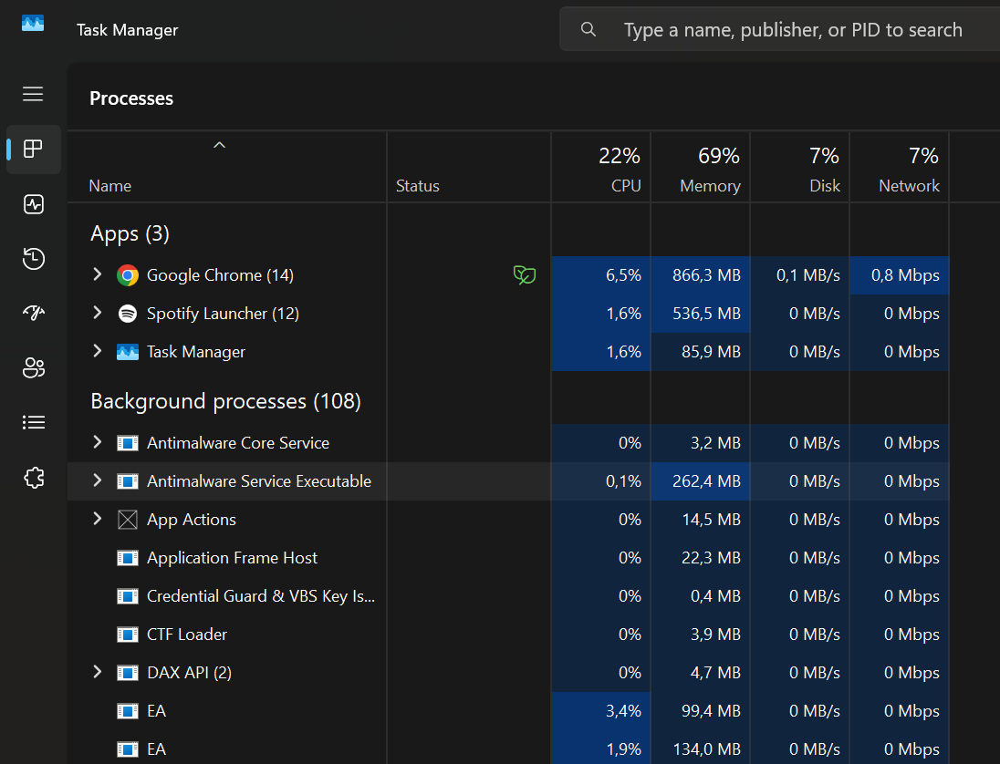
Pembahasan: 
Menampilkan antarmuka Task Manager pada sistem operasi Windows yang menyajikan daftar proses aplikasi aktif beserta persentase penggunaan CPU dan memori secara keseluruhan. 

### 2.
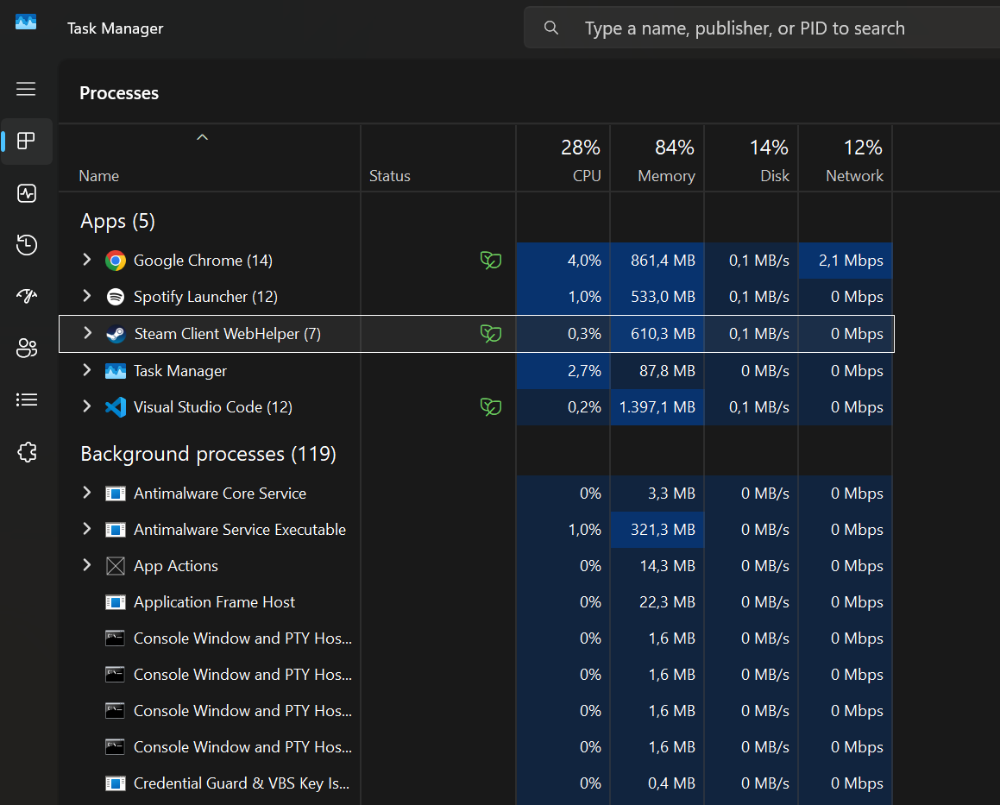
Pembahasan: 
Menampilkan Task Manager saat pemantauan proses (Steam) dilanjutkan dengan rincian tambahan aplikasi yang berjalan di latar belakang serta alokasi sumber daya sistem yang sedang digunakan.

### 3.
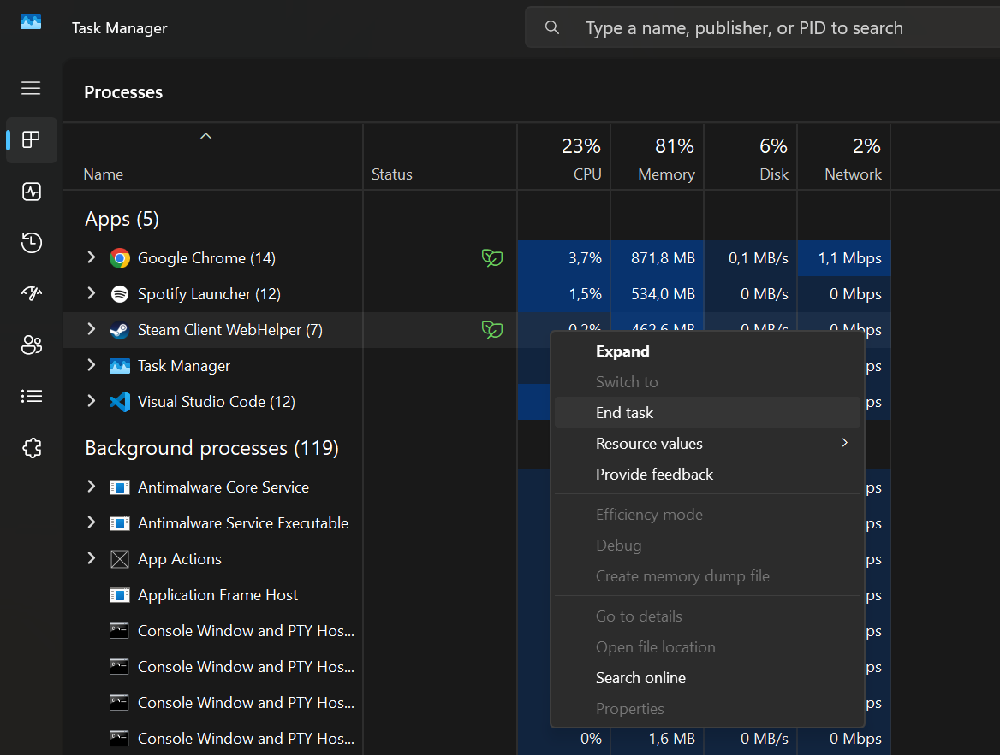
Pembahasan: 
Menampilkan menu konteks interaktif pada Task Manager yang digunakan untuk mengelola, memperluas, atau menghentikan proses tertentu secara langsung dari sistem operasi, namun disini akan di End Task.

### 4.
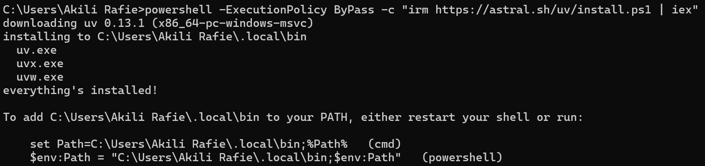
Pembahasan: 
Menampilkan proses pengunduhan dan instalasi package manager uv melalui PowerShell menggunakan skrip resmi Astral untuk menyiapkan lingkungan pengembangan yang cepat.

### 5.
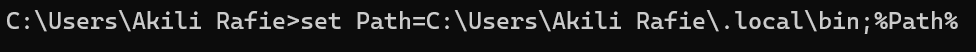
Pembahasan: 
Menampilkan daftar perintah utama dan panduan bantuan penggunaan utilitas uv setelah berhasil terinstal di dalam sistem komputer pengguna.

### 6.
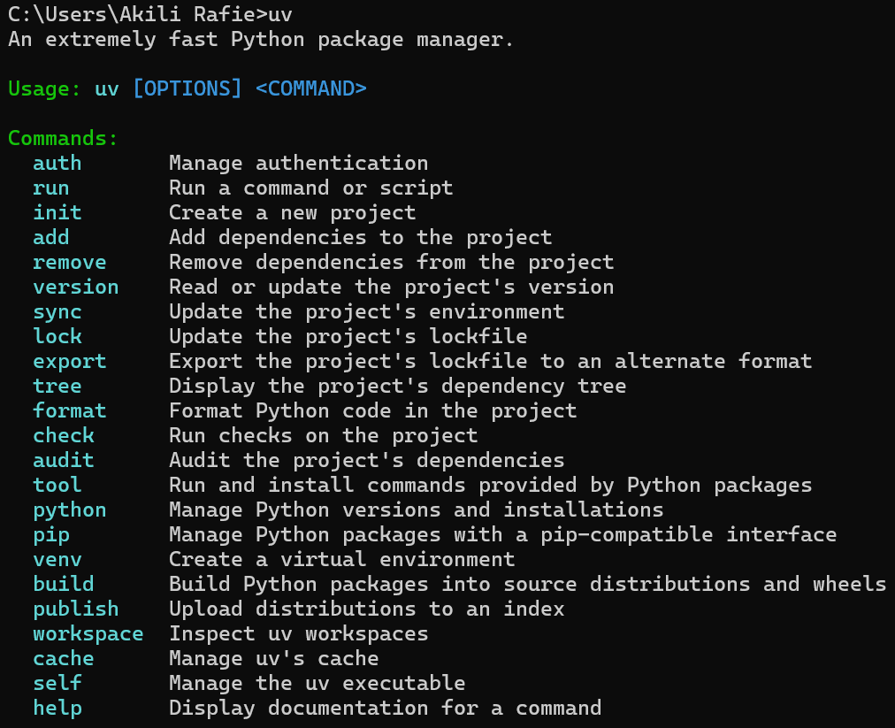
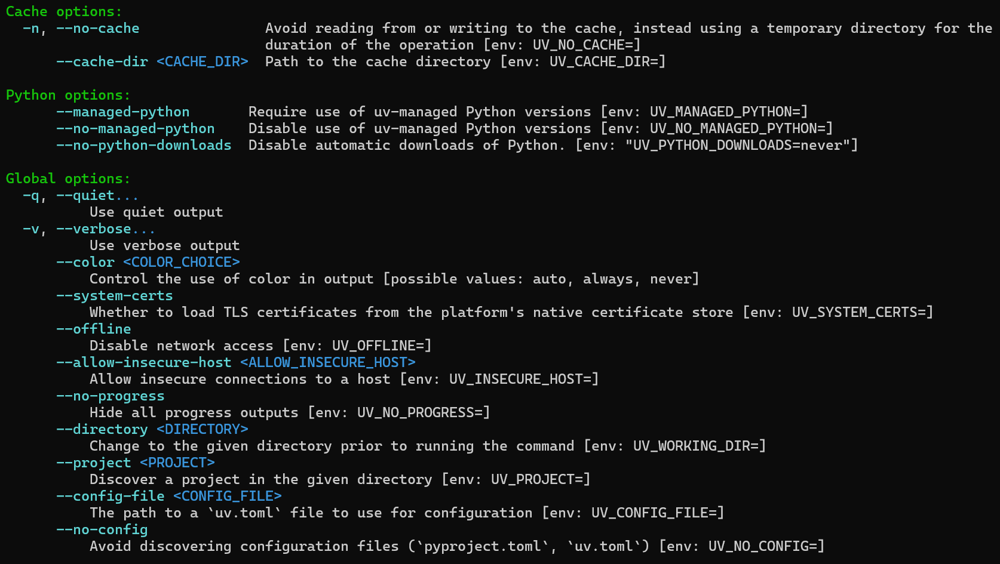
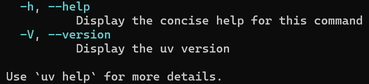
Pembahasan: 
Menampilkan konfigurasi opsi cache dan pengaturan global utilitas uv, dilanjutkan dengan pemeriksaan pembaruan versi uv, pembuatan serta navigasi direktori kerja baru, hingga penampilan daftar lengkap versi interpreter Python yang siap dikelola.

### 7.
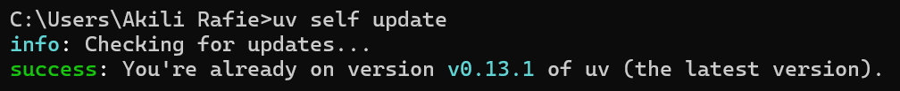
Pembahasan:
Menampilkan utilitas uv untuk self update agar otomatis update versi yang lebih terbaru.

### 8.
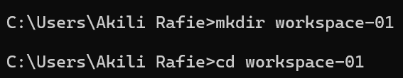
Pembahasan: 
Perintah mkdir digunakan untuk membuat direktori atau folder baru agar file proyek terorganisasi dengan baik, sedangkan perintah cd berfungsi untuk masuk dan berpindah ke dalam folder tersebut sehingga seluruh perintah maupun proses selanjutnya tereksekusi pada ruang kerja yang tepat.

### 9.
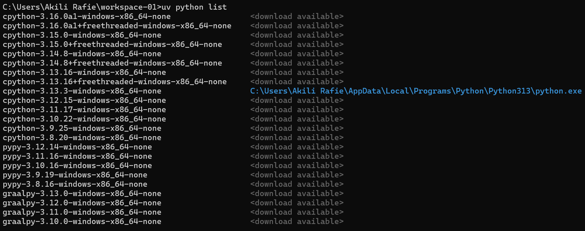
Pembahasan: 
Perintah uv python list digunakan untuk menampilkan daftar versi interpreter Python yang tersedia di dalam sistem komputer maupun yang siap diunduh dan dikelola secara langsung oleh utilitas uv.

### 10.
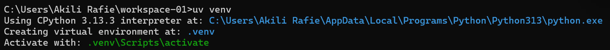
Pembahasan: 
Perintah uv venv digunakan untuk membuat lingkungan virtual (virtual environment) Python baru dengan sangat cepat, yang berfungsi untuk mengisolasi dependensi dan pustaka proyek agar tidak bercampur dengan instalasi Python global pada sistem komputer.

### 11.
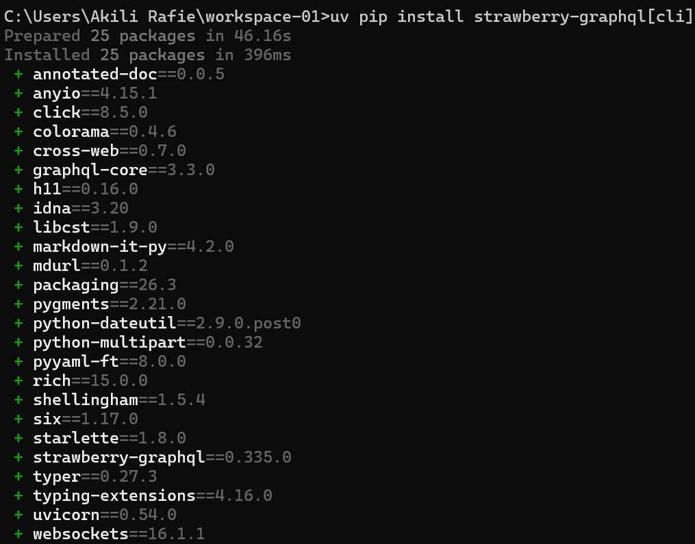
Pembahasan: 
Perintah uv pip install strawberry digunakan untuk menginstal pustaka Strawberry GraphQL beserta seluruh dependensinya ke dalam virtual environment secara cepat dan efisien menggunakan pengelola paket berbasis uv.

### 12.
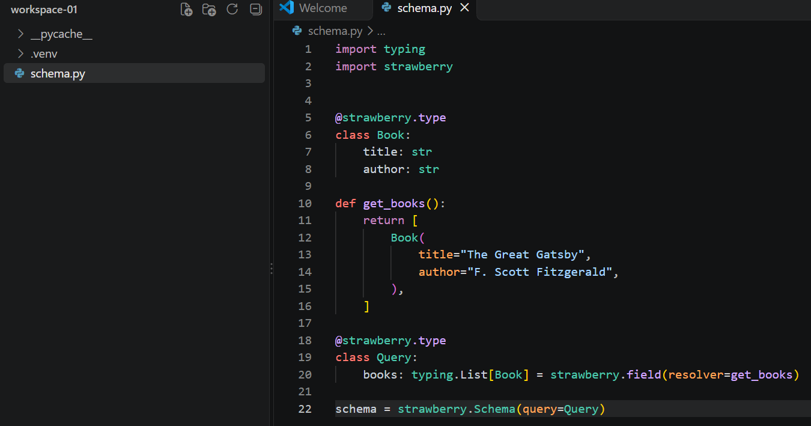
Pembahasan: 
Menampilkan penulisan kode sumber schema.py di editor VS Code menggunakan pustaka Strawberry untuk mendefinisikan tipe data Book dan Query GraphQL. 

### 13.
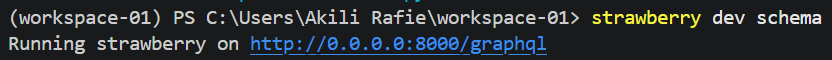
Pembahasan: 
Menampilkan eksekusi server pengembangan GraphQL melalui terminal dengan perintah strawberry dev schema yang aktif pada alamat http://localhost:8000/graphql atau http://0.0.0.0:8000/graphql.

### 14.
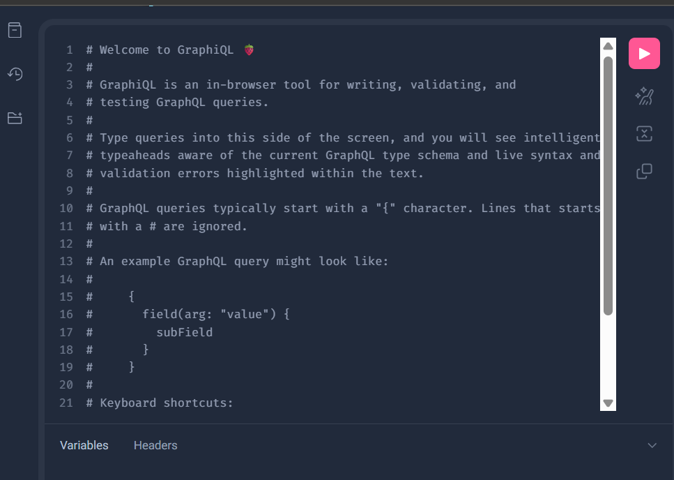
Pembahasan: 
Menampilkan antarmuka bawaan GraphiQL di dalam peramban web yang menyediakan dokumentasi interaktif dan panduan penulisan query GraphQL.

### 15.
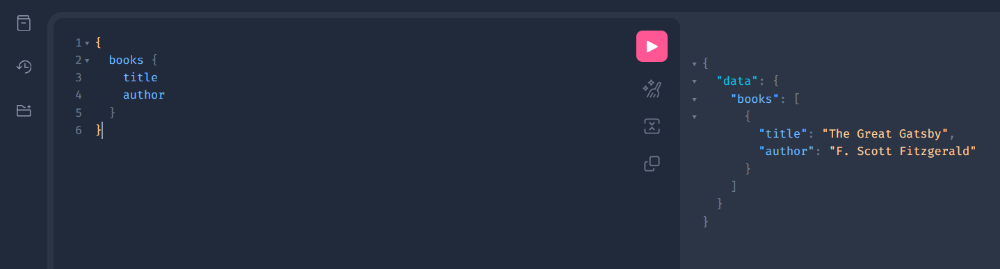
Pembahasan: 
Menampilkan penulisan query GraphQL di antarmuka GraphiQL untuk mengambil data atribut title dan author dari entitas daftar buku dan menampilkan hasil respon format JSON dari server GraphQL yang sukses mengembalikan data buku The Great Gatsby beserta nama penulisnya.

---

## Kesimpulan
Kesimpulan dari praktikum ini menunjukkan bahwa pengelolaan sistem terdistribusi mencakup manajemen proses tingkat dasar pada sistem operasi melalui pemantauan dan penghentian proses via command line, efisiensi penyiapan environment Python menggunakan utilitas modern uv.