# Laporan Praktikum Sistem Terdistribusi dan Terdesentralisasi

---

| Nama | NIM |
| --- | --- |
| Akili Rafie Hendarto | 255410007 |

---
## Minggu 03 - Sinkronisasi pada Sistem Terdistribusi 
---

## Tujuan Praktikum
Tujuan praktikum adalah untuk mempelajari konsep-konsep penting terkait sinkronisasi dan konsensus dalam sistem terdistribusi. Lingkup pembelajarannya mencakup praktik sinkronisasi waktu menggunakan protokol NTP (Network Time Protocol) atau PTP (Precision Time Protocol) pada sistem operasi yang berbeda.

## Dasar Teori
Dasar teori praktikum ini adalah Sinkronisasi waktu via NTP atau PTP diperlukan untuk mengurutkan kejadian dan menjaga konsistensi antar-node yang terpisah secara fisik. Untuk pengurutan event dan analisis hubungan kausalitas (happens-before atau concurrent) digunakan vector clock. Sementara itu, dalam pemrograman multithreading, ketiadaan sinkronisasi dapat memicu dua masalah utama: data race akibat akses sumber daya bersama tanpa kontrol, serta deadlock akibat proses yang saling menunggu kunci secara permanen. Untuk mencapai kesepakatan dalam sistem terdistribusi, digunakan Algoritma Raft yang mengatur pemilihan pemimpin (Leader Election), pengiriman heartbeat, dan replikasi log.

## Pembahasan Praktikum

### 1. Menginstall Nettime

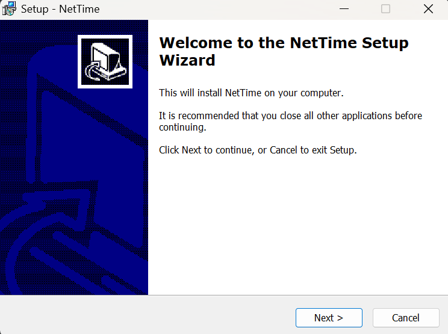
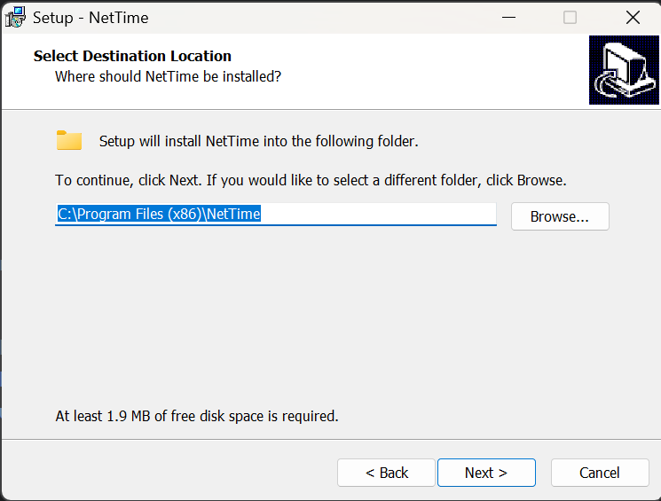
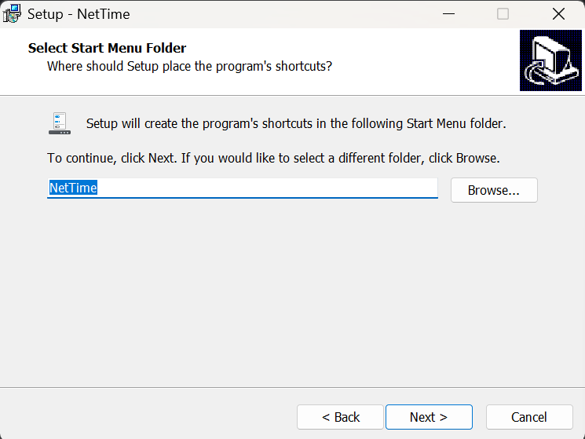
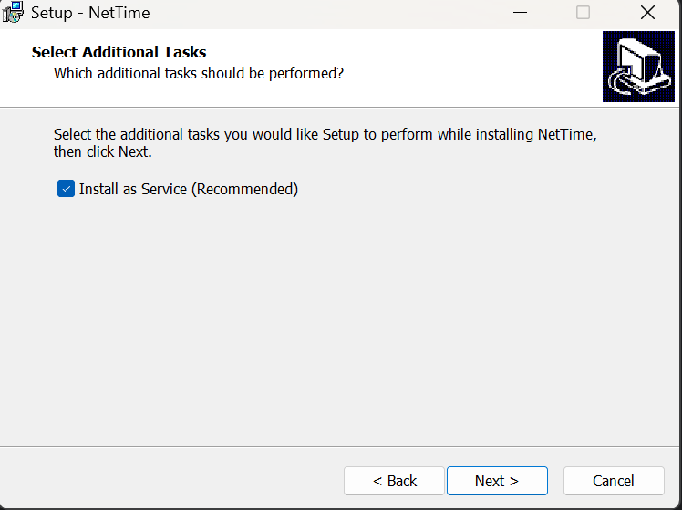
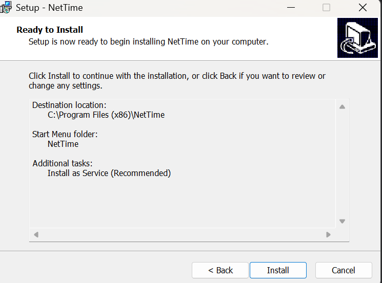
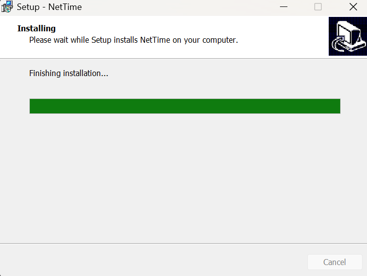
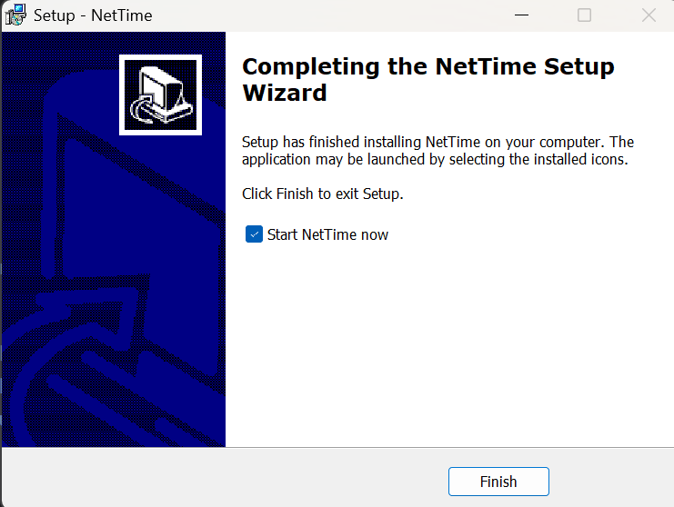
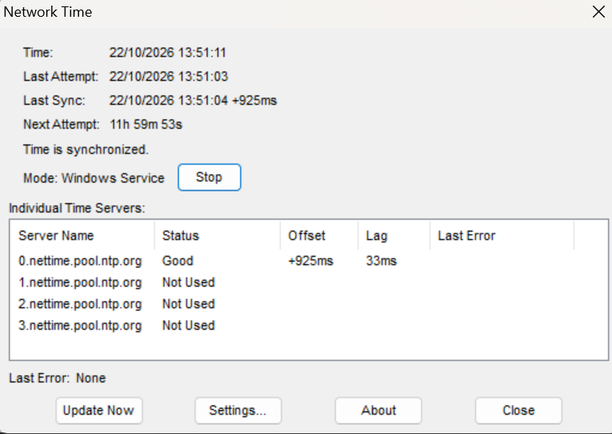
Pembahasan: 
Setelah klik link https://www.timesynctool.com/ untuk download NetTime akan muncul seperti pengaturan awal sebelum sepenuhnya instalasi seperti pada gambar gambar diatas. Setelah tahapan instalasi NetTime selesai, aplikasi NetTime dapat langsung dijalankan (start) melalui shortcut di desktop, di mana program tersebut kemudian siap beroperasi untuk menghubungkan komputer ke server NTP eksternal guna menyelaraskan dan menjaga akurasi waktu pada sistem terdistribusi. Pada gambar terakhir, merupakan tampilan ketika NetTime sudah di jalankan.

### 2. Vektor Clock
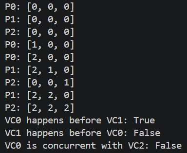
Pembahasan: 
Program ini menerapkan Vector Clock untuk mencatat urutan kejadian dan hubungan kausal antarproses dalam sistem terdistribusi. Method increment() menambah nilai jam lokal, send_message() mengirim nilai vector clock, dan receive_message() memperbarui jam saat menerima pesan. Method happens_before() memeriksa hubungan kausal, sedangkan is_concurrent() memeriksa apakah dua kejadian berlangsung secara konkuren. Program menyimulasikan tiga proses, yaitu P0, P1, dan P2, yang saling bertukar pesan. Hasil akhirnya menunjukkan bahwa VC0 terjadi sebelum VC1 bernilai True, VC1 terjadi sebelum VC0 bernilai False, dan VC0 konkuren dengan VC2 bernilai True.

### 3. Tugas Vektor Clock
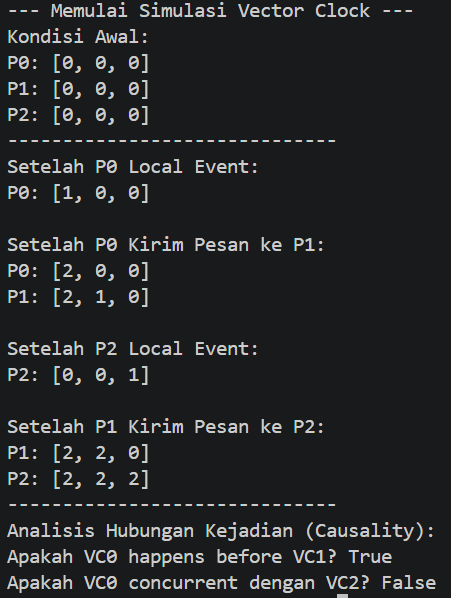
Pembahasan: 
Program ini menerapkan Vector Clock untuk mencatat urutan kejadian dan hubungan kausal pada tiga proses, yaitu P0, P1, dan P2. Method increment() menambah nilai jam lokal, send_message() mengirim informasi waktu, sedangkan receive_message() memperbarui vector clock saat menerima pesan. Output program menunjukkan perubahan nilai jam dari kondisi awal [0, 0, 0] setelah kejadian lokal dan pertukaran pesan. Pada akhir simulasi, nilai P0 menjadi [2, 0, 0], P1 menjadi [2, 2, 0], dan P2 menjadi [2, 2, 2]. Hasil analisis menunjukkan VC0 happens before VC1 bernilai True dan VC0 concurrent dengan VC2 juga bernilai True, yang menunjukkan hubungan urutan kejadian dan konkurensi antarproses dalam sistem terdistribusi.

### 4. Multithread
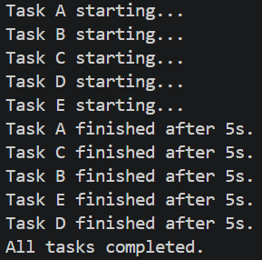
Pembahasan: 
Program ini menggunakan modul threading untuk menjalankan lima tugas, yaitu A, B, C, D, dan E, secara konkuren dengan waktu tunggu masing-masing 5 detik melalui time.sleep(). Output urutan pesan dapat berbeda setiap kali program dijalankan karena setiap thread berjalan secara independen dan sistem operasi mengatur penjadwalan eksekusinya. Method start() memulai setiap thread, sedangkan join() memastikan program menunggu seluruh thread selesai sebelum menampilkan pesan "All tasks completed.". Meskipun urutan pesan dapat berbeda, seluruh tugas tetap membutuhkan waktu sekitar 5 detik secara bersamaan.

### 5. Data race
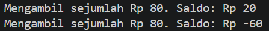
Pembahasan: 
Program ini menerapkan multithreading untuk menjalankan dua proses penarikan saldo secara bersamaan dengan saldo awal 100. Fungsi withdraw() memeriksa apakah saldo mencukupi sebelum melakukan penarikan sebesar 80, sedangkan time.sleep(0.01) memberi jeda yang dapat menyebabkan kedua thread membaca saldo awal yang sama sebelum mengubahnya. Akibatnya, kedua thread berpotensi berhasil menarik uang meskipun saldo tidak mencukupi untuk keduanya. Kondisi ini disebut race condition, yaitu ketika beberapa thread mengakses dan mengubah data bersama secara bersamaan sehingga hasilnya tidak sesuai harapan.

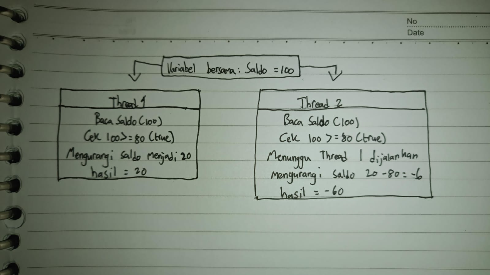
Pembahasan:
Kedua thread membaca saldo awal sebesar 100 dan memeriksa bahwa saldo mencukupi untuk penarikan 80. Thread 1 mengurangi saldo menjadi Rp20, sedangkan Thread 2 yang sudah melakukan pemeriksaan sebelumnya tetap melanjutkan penarikan sehingga saldo menjadi -Rp60. Kondisi ini terjadi karena proses pemeriksaan dan pengurangan saldo tidak berjalan secara aman.

Pembahasan: 
Program ini menggunakan threading.Lock() untuk mencegah race condition saat dua thread melakukan penarikan saldo secara bersamaan. Perintah with counter_lock memastikan proses pemeriksaan dan pengurangan saldo hanya dilakukan oleh satu thread pada satu waktu. Dengan saldo awal Rp100 dan penarikan masing-masing Rp80, hanya satu thread yang berhasil menarik uang sehingga saldo akhir menjadi Rp20. Thread lainnya tidak melakukan penarikan karena saldo sudah tidak mencukupi. Race condition tidak terjadi karena program menggunakan threading.Lock() untuk mengunci akses ke variabel balance.

### 6. Deadlock
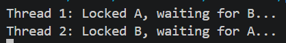
Pembahasan: 
Program ini menunjukkan terjadinya deadlock pada sistem multithreading karena dua thread mengunci sumber daya dengan urutan yang berbeda. 

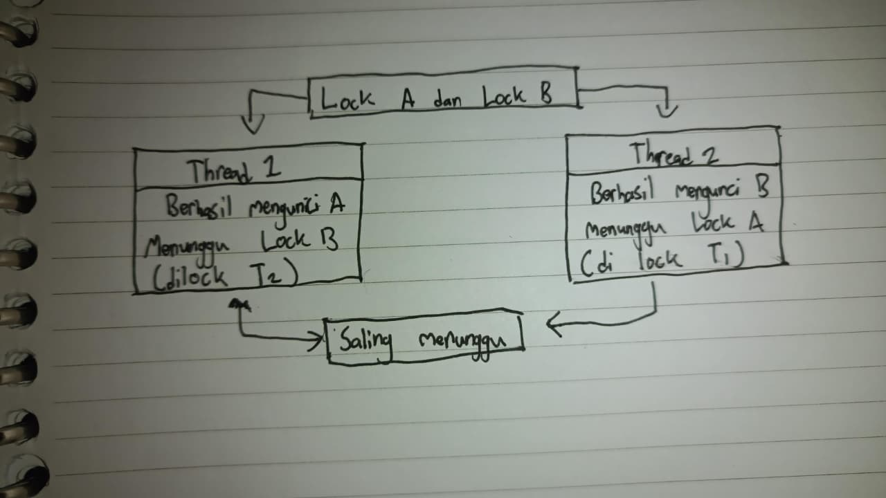
Pembahasan:Thread 1 mengunci lock_a dan menunggu lock_b, sedangkan Thread 2 mengunci lock_b dan menunggu lock_a. Perintah time.sleep(1) meningkatkan kemungkinan kedua thread saling menunggu. Akibatnya, kedua thread tidak dapat melanjutkan proses dan program akan terhenti saat menjalankan join().

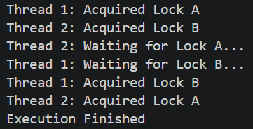
Pembahasan: 
Program ini menggunakan threading.Lock() dengan parameter timeout=5 untuk mencegah deadlock ketika dua thread mengakses Lock A dan Lock B. Setiap thread mengunci sumber daya yang dibutuhkan, kemudian melepaskan kunci melalui finally sebelum mencoba mengambil kunci berikutnya. Dengan cara ini, kedua thread tidak saling menunggu kunci yang masih dipegang secara bersamaan. Output menampilkan proses pengambilan dan pelepasan kunci oleh Thread 1 dan Thread 2, lalu diakhiri dengan pesan "Execution Finished". 

### 7. Algoritma Raft
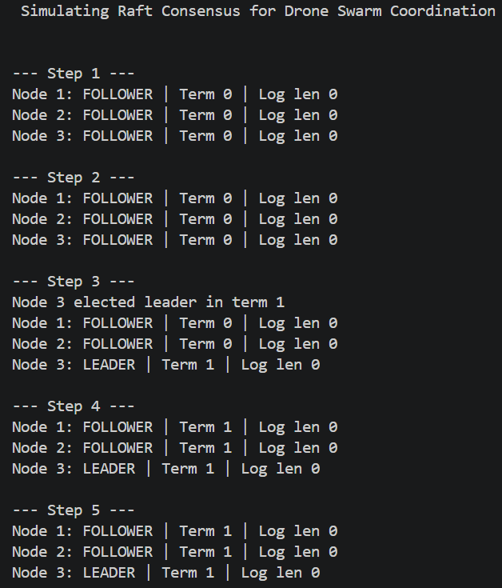
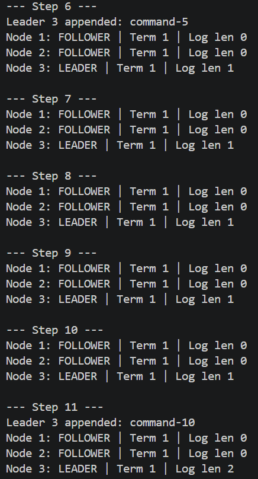
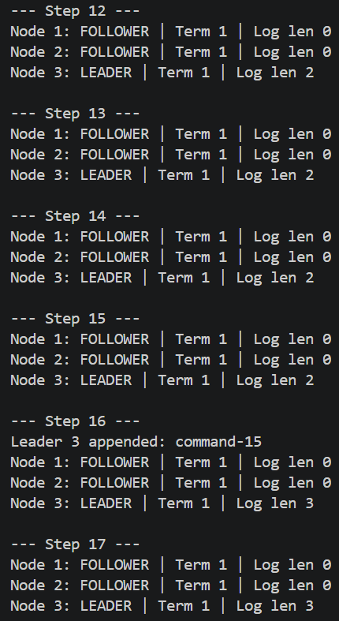
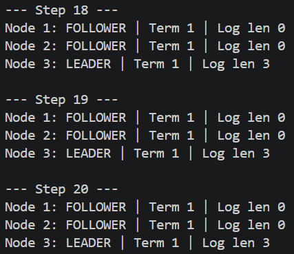
Pembahasan:
Program ini menyimulasikan algoritma Raft Consensus untuk memilih pemimpin (leader) dalam sistem terdistribusi, seperti koordinasi drone. Class State menentukan tiga status node, yaitu Follower, Candidate, dan Leader. Method start_election() menjalankan pemilihan pemimpin berdasarkan jumlah suara mayoritas, sedangkan on_heartbeat() memperbarui status node ketika menerima sinyal dari leader. Method append_entry() menambahkan perintah ke log jika node berstatus Leader, sementara tick() memeriksa waktu untuk memulai pemilihan baru. Output menampilkan 20 langkah simulasi yang berisi status, term, dan panjang log setiap node.

### 8. Tugas Algoritma Raft
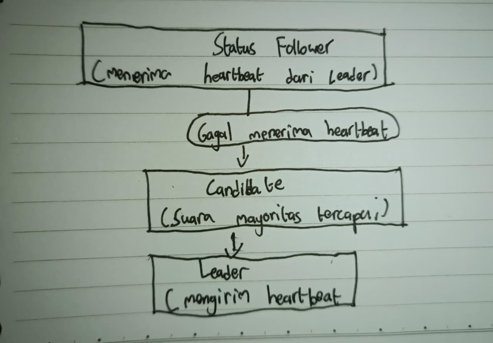
Pembahasan: Follower adalah node yang bertindak sebagai pengikut dalam sistem terdistribusi. Follower menerima pesan heartbeat dari Leader secara berkala. Heartbeat berfungsi sebagai tanda bahwa Leader masih aktif dan beroperasi. Jika Follower tidak menerima heartbeat dari Leader dalam jangka waktu tertentu, Follower menganggap Leader mungkin mengalami kegagalan atau tidak dapat dihubungi. Node yang mendeteksi kegagalan dapat berubah menjadi Candidate atau kandidat pemimpin. Candidate mengajukan dirinya sebagai calon Leader dan meminta suara dari node lain. Jika kandidat memperoleh suara mayoritas sesuai aturan protokol, kandidat tersebut dapat terpilih menjadi Leader. Setelah terpilih, Leader baru mengirimkan heartbeat secara berkala kepada Follower. Pesan ini menunjukkan bahwa Leader masih aktif.

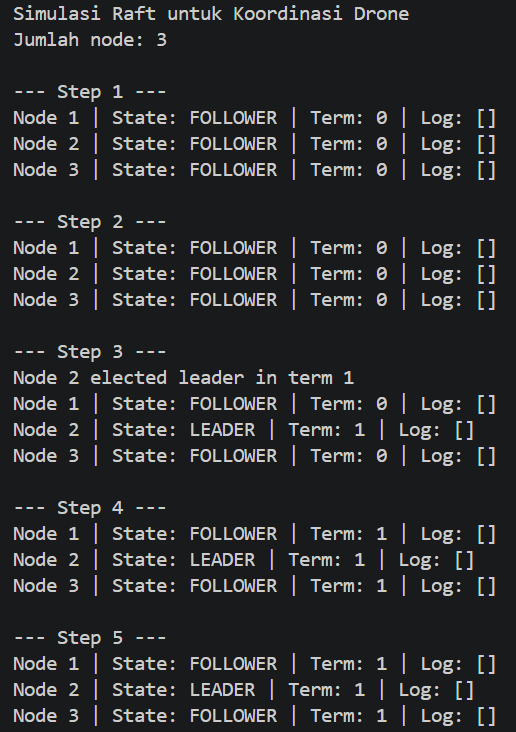
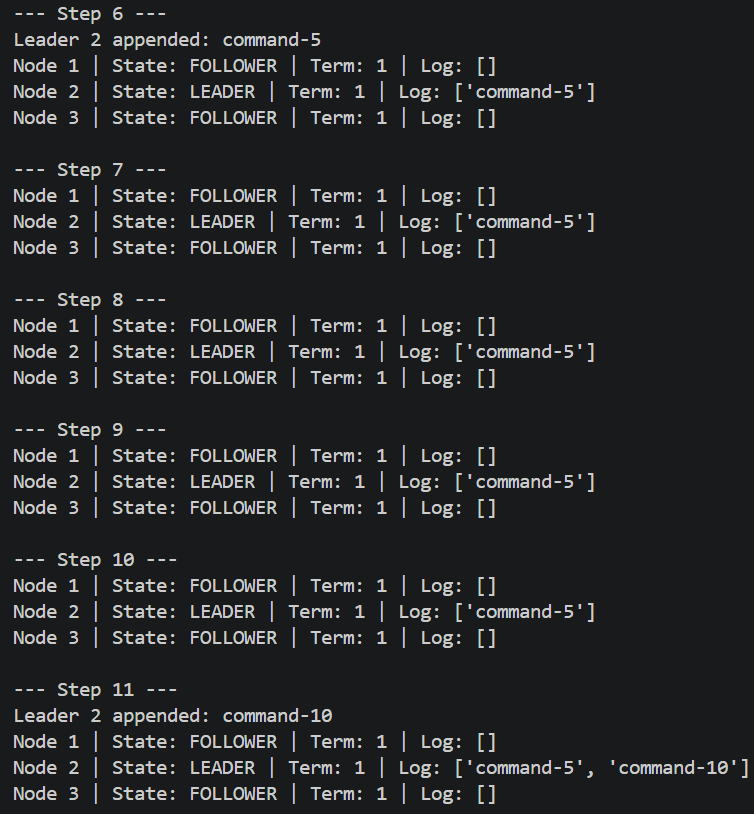
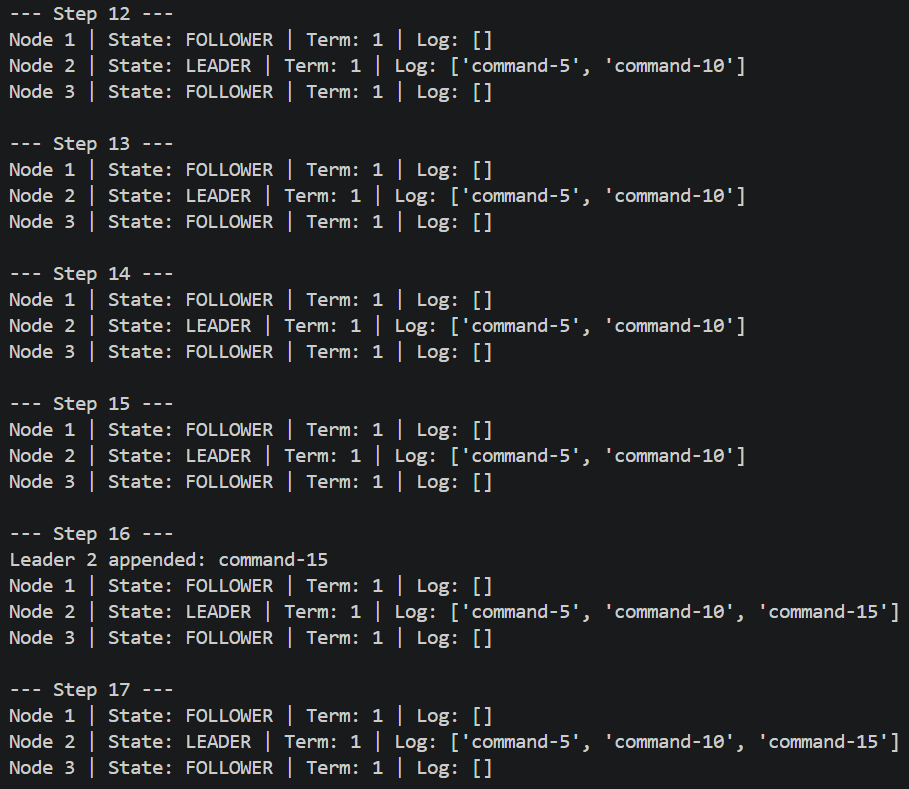
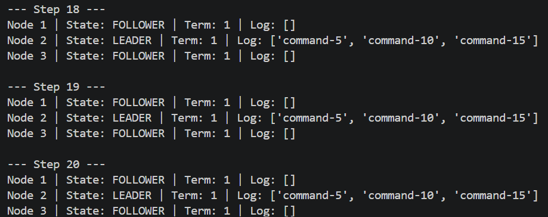
Pembahasan: Program ini menyimulasikan algoritma Raft Consensus untuk koordinasi drone menggunakan tiga node. Program memeriksa node yang berstatus Leader, mengirim heartbeat kepada node lain, dan menambahkan perintah ke log setiap lima langkah jika terdapat leader. Method tick() memeriksa kondisi setiap node untuk menentukan apakah perlu memulai pemilihan pemimpin. Output menampilkan 20 langkah simulasi beserta status node, term, dan isi log masing-masing. Command berfungsi sebagai perintah atau instruksi yang dikirimkan kepada node seperti command-0, command-5, command-10, dan command-15. Perintah tersebut ditambahkan ke log oleh node yang berstatus Leader.

---

## Kesimpulan
Kesimpulan dari praktikum ini mempelajari komunikasi antarproses, pengurutan kejadian menggunakan Vector Clock, serta penerapan multithreading. Penggunaan thread dapat meningkatkan efisiensi proses, tetapi juga berpotensi menimbulkan race condition yang dapat dicegah menggunakan Lock. Penggunaan beberapa kunci dengan urutan yang berbeda dapat menyebabkan deadlock sehingga diperlukan pengelolaan kunci yang tepat. Selain itu, algoritma Raft Consensus digunakan untuk memahami pemilihan pemimpin, komunikasi melalui heartbeat, dan pencatatan perintah pada node dalam sistem terdistribusi.