# Laporan Praktikum Sistem Terdistribusi dan Terdesentralisasi

---

| Nama | NIM |
| --- | --- |
| Akili Rafie Hendarto | 255410007 |

---
## Minggu 04 - Konsistensi dan Replikasi pada Sistem Terdistribusi
---

## Tujuan Praktikum
Tujuan praktikum adalah untuk memahami penerapan konsep sistem terdistribusi melalui penggunaan container dan pengelolaan data pada lingkungan basis data. Mahasiswa diharapkan mampu menyiapkan lingkungan praktikum menggunakan Docker, menjalankan serta memeriksa layanan yang diperlukan, membuat struktur tabel dan mengelola data menggunakan SQL, serta mengamati hasil pemrosesan data.

## Dasar Teori
Dasar teori praktikum ini adalah Docker merupakan platform yang digunakan untuk menjalankan aplikasi beserta kebutuhan lingkungannya dalam container. Container menyediakan lingkungan yang terisolasi dan relatif konsisten, sehingga aplikasi dapat dijalankan tanpa harus memasang seluruh dependensi secara langsung pada sistem utama. Docker Compose membantu mengatur beberapa layanan dalam satu proyek melalui berkas konfigurasi, sehingga layanan pendukung praktikum dapat disiapkan dan dijalankan secara lebih terstruktur. Apache Ignite adalah platform komputasi dan penyimpanan data terdistribusi yang dapat digunakan untuk mengolah serta mengakses data melalui beberapa node. Struktur tabel ditentukan melalui skema, termasuk nama kolom dan tipe data. SQL digunakan untuk mengelola basis data, antara lain membuat tabel, memasukkan data, membaca data, memperbarui nilai, serta mengolah hasil query. Hasil query perlu diperiksa untuk memastikan data yang ditampilkan sesuai dengan struktur dan kebutuhan pengolahan. Replikasi merupakan salah satu pendekatan untuk menyalin data dari satu server ke server lain, misalnya untuk mendukung ketersediaan data atau kebutuhan pembacaan. Kondisi setiap server perlu diperiksa karena server dapat memiliki peran dan status yang berbeda. Perubahan pada data juga perlu diverifikasi agar diketahui apakah proses berhasil dan apakah hasilnya sesuai dengan kondisi data serta kriteria yang digunakan.

## Pembahasan Praktikum
(Saya akan memberikan pembahasan sesuai dokumentasi menggunakan nomer urut)
### 1. Instalasi Docker

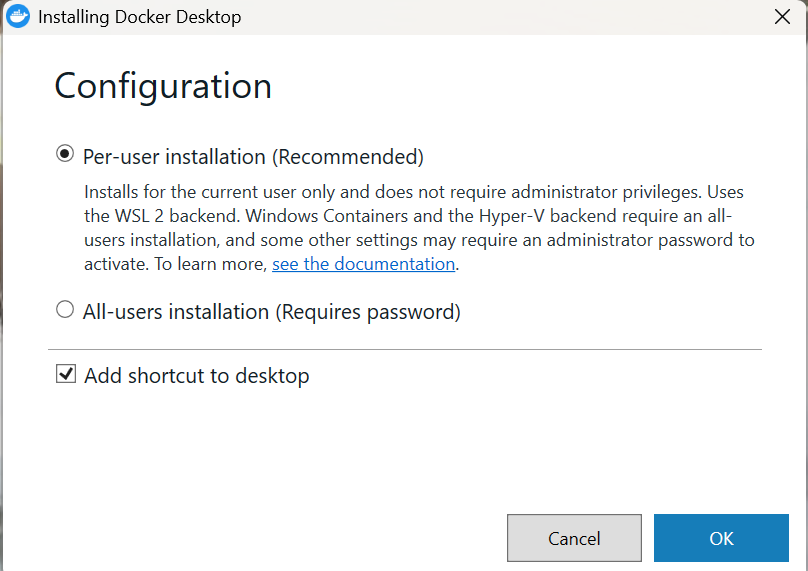
Pembahasan: 
Pengaturan awal instalasi Docker Desktop pada Windows, termasuk pilihan cakupan instalasi dan pembuatan pintasan. Pengaturan ini menentukan bagaimana aplikasi dipasang dan diakses. Sebelum melanjutkan, pilihan yang tersedia perlu disesuaikan dengan kebutuhan pengguna dan kondisi komputer agar aplikasi dapat digunakan dengan baik setelah pemasangan.

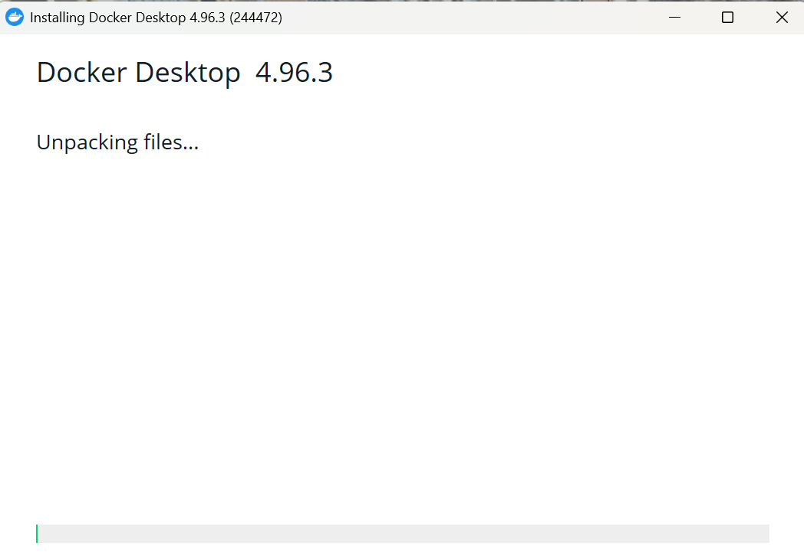
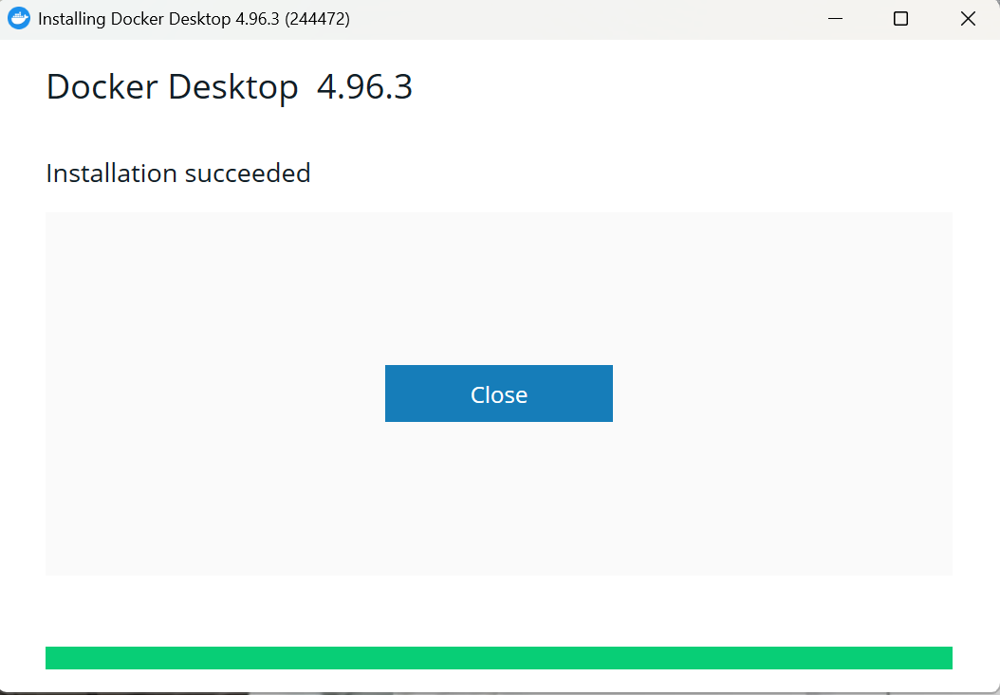
Pembahasan: 
Pada tahap ini, berkas yang diperlukan sedang diproses sebelum aplikasi siap digunakan. Proses sebaiknya dibiarkan sampai selesai dan jendela instalasi tidak ditutup lebih awal, karena penghentian dapat menyebabkan pemasangan tidak lengkap.
Keberhasilan pemasangan ini menandakan bahwa aplikasi siap dibuka untuk mengelola container.

### 2. Cek Versi
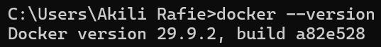
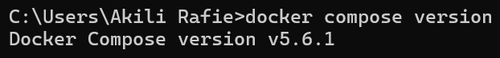
Pembahasan: 
Menampilkan pemeriksaan versi Docker melalui terminal, informasi versi yang muncul menunjukkan bahwa perangkat lunak telah terpasang dan dapat dikenali oleh sistem. Pemeriksaan ini penting sebagai verifikasi awal sebelum menjalankan layanan. 
Menampilkan pemeriksaan versi Dockere Compose melalui terminal, komponen ini berguna untuk mengatur beberapa layanan agar dapat dijalankan bersama berdasarkan konfigurasi proyek. 

### 3. Folder streaming-replication
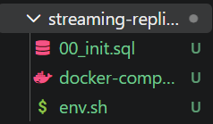
Pembahasan: 
Ada tiga berkas yang harus disiapkan di dalam folder streaming-replication. 00_init.sql berisi perintah yang dijalankan sekali saat primary pertama kali dibuat, docker-compose.yaml mendefinisikan dua service PostgreSQL beserta konfigurasinya, dan env.sh menyimpan alias agar perintah panjang tidak perlu diketik ulang.

00_init.sql digunakan untuk membuat pengguna bernama replicator yang memiliki izin untuk melakukan replikasi database PostgreSQL. Perintah berikutnya digunakan untuk membuat slot replikasi bernama replication_slot yang berfungsi membantu proses pengiriman data dari server utama ke server replika. Program ini bertujuan untuk menyiapkan akun dan slot yang dibutuhkan dalam proses replikasi database.

docker-compose.yaml digunakan untuk menjalankan dua server PostgreSQL, yaitu server utama (postgres_primary) dan server replika (postgres_replica). Server utama bertugas menyimpan data dan mengirimkan perubahan data, sedangkan server replika menyalin data dari server utama menggunakan perintah pg_basebackup. Konfigurasi ini juga mengatur koneksi, penyimpanan data, dan pemeriksaan kondisi server. Program ini bertujuan untuk membuat sistem replikasi database agar server replika memiliki salinan data dari server utama.

env.sh berisi kumpulan perintah singkat untuk mempermudah pengelolaan Docker melalui terminal. Perintah dcu digunakan untuk menjalankan container, dcd untuk menghentikannya, dan dps untuk melihat daftar container yang berjalan. Perintah der dan dep digunakan untuk masuk ke terminal server replika dan server utama, sedangkan dlr dan dlp digunakan untuk melihat log kedua server.

### 4. Install WSL
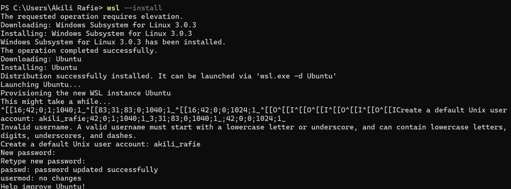
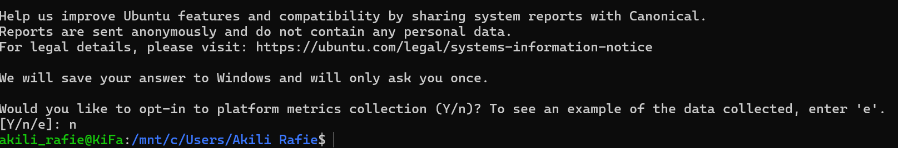
Pembahasan: 
wsl --install merupakan komponen yang dapat digunakan untuk mendukung Docker pada Windows adalah Windows Subsystem for Linux atau WSL. Komponen ini menyediakan lingkungan Linux yang dapat membantu menjalankan berbagai perintah dan layanan yang dibutuhkan. Melalui terminal, pengguna dapat menjalankan perintah untuk memeriksa konfigurasi, mengakses direktori proyek, dan memastikan layanan yang dibutuhkan tersedia. Tahap ini membantu pengguna mengetahui apakah lingkungan kerja sudah siap sebelum menjalankan database.

### 5. Tampilan WSL dan Docker
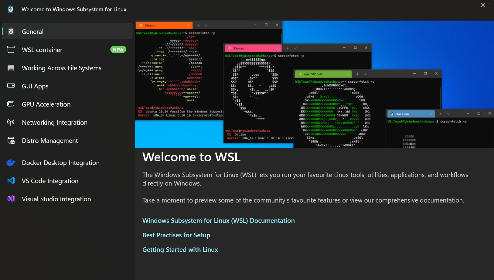
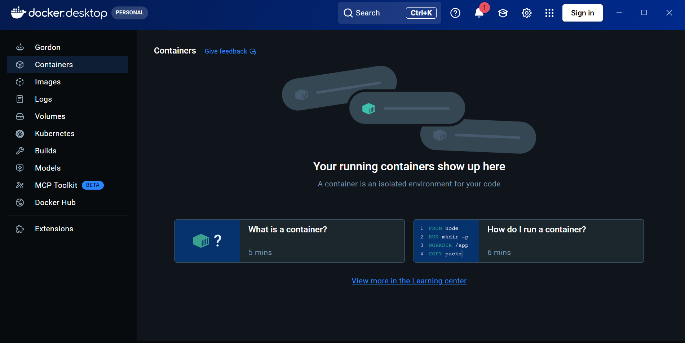
Pembahasan: 
Gambar pertama menunjukkan penggunaan lingkungan Windows Subsystem for Linux atau WSL untuk menjalankan perintah berbasis Linux pada Windows. Lingkungan ini memungkinkan pengguna mengakses terminal Linux tanpa harus memasang sistem operasi Linux secara terpisah. Gambar kedua menampilkan antarmuka Docker Desktop yang digunakan untuk melihat dan mengelola layanan atau container. Status pada antarmuka membantu pengguna mengetahui apakah suatu komponen telah dibuat, sedang berjalan, atau perlu diperiksa.

### 6. Docker Compose Up
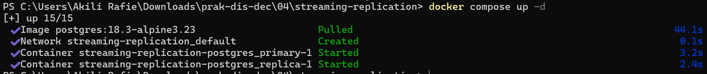
Pembahasan: 
Menunjukkan penggunaan perintah docker compose up -d untuk menjalankan layanan yang telah ditentukan dalam berkas docker-compose.yml. Perintah tersebut membuat dan menjalankan container PostgreSQL sesuai dengan konfigurasi yang tersedia. Opsi -d membuat container berjalan di latar belakang sehingga terminal tetap dapat digunakan untuk menjalankan perintah lain. 

### 7. Docker Table
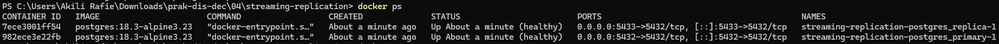
Pembahasan:
Perintah docker ps digunakan untuk menampilkan daftar container Docker yang sedang berjalan. Informasi yang ditampilkan meliputi nama container, ID container, status, port, dan image yang digunakan. Perintah ini bertujuan untuk memeriksa apakah container yang dijalankan, seperti server PostgreSQL atau Apache Ignite, sudah aktif dan berjalan dengan baik.

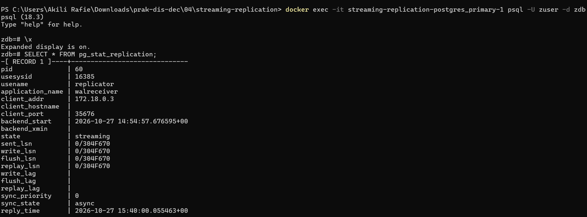
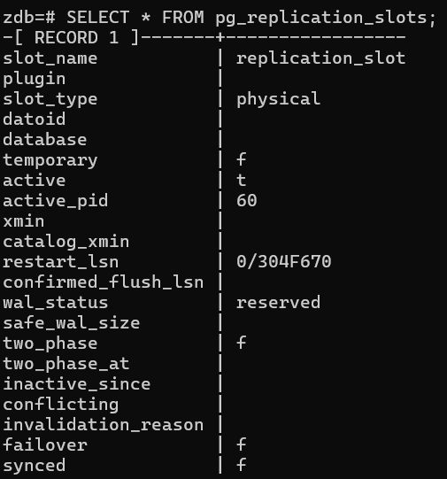
Pembahasan: 
Gambar pertama menunjukkan pemeriksaan kondisi server PostgreSQL setelah container berhasil dijalankan. Pemeriksaan ini dilakukan untuk mengetahui apakah layanan database sudah siap menerima koneksi dan menjalankan perintah SQL. Kondisi server perlu dipastikan sebelum proses replikasi diuji agar hasil pengujian dapat diperiksa dengan benar.
Gambar kedua menunjukkan penggunaan perintah SELECT * FROM pg_replication_slots untuk menampilkan informasi slot replikasi yang tersedia pada PostgreSQL. Slot replikasi digunakan untuk membantu menjaga catatan perubahan database yang diperlukan oleh server replika. Hasil pemeriksaan menampilkan slot bernama replication_slot dengan jenis fisik. Slot tersebut telah disiapkan untuk mendukung pengiriman data dari server utama ke server replika.

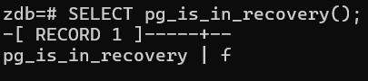
Pembahasan:
Menunjukkan penggunaan perintah SELECT pg_is_in_recovery() untuk memeriksa apakah server PostgreSQL sedang berada dalam mode pemulihan. Perintah ini menghasilkan nilai true atau false berdasarkan kondisi server yang diperiksa. Jika hasilnya false, server tersebut tidak sedang berada dalam mode pemulihan sebagai replika. Sebaliknya, jika hasilnya true, server sedang berada dalam mode pemulihan yang biasanya digunakan oleh server replika.

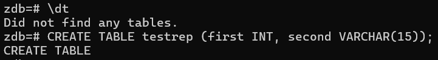
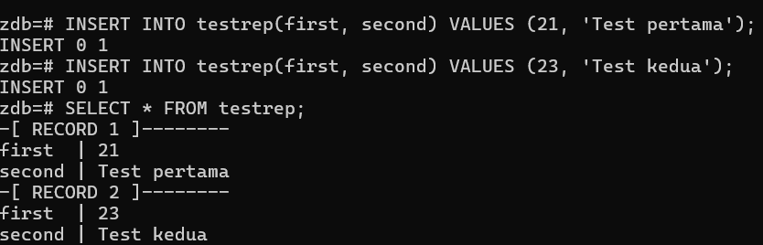
Pembahasan: 
Perintah \dt digunakan untuk menampilkan daftar tabel yang tersedia dalam database. Setelah itu, tabel testrep dibuat dengan kolom first bertipe bilangan bulat dan kolom second bertipe teks. Kedua kolom tersebut digunakan untuk menyimpan data sederhana yang akan dipakai dalam pengujian replikasi. Data yang dimasukkan terdiri dari angka 21 dengan teks Test pertama dan angka 23 dengan teks Test kedua. Setelah data dimasukkan, perintah SELECT * FROM testrep digunakan untuk menampilkan seluruh isi tabel. Hasil pemeriksaan membantu memastikan bahwa kedua data telah tersimpan pada server utama.

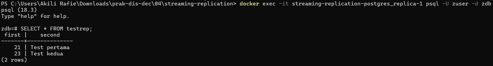
Pembahasan:
Pemeriksaan ini dilakukan setelah data dimasukkan ke dalam tabel pada server utama. Hasilnya menampilkan data angka 21 dengan teks Test pertama serta angka 23 dengan teks Test kedua. Kesamaan data tersebut menunjukkan bahwa perubahan yang dilakukan pada server utama telah diterima oleh server replika.

### 8. Docker Compose Stop
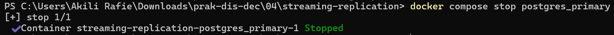
Pembahasan: 
Menunjukkan penggunaan perintah docker compose stop postgres_primary untuk menghentikan layanan server utama PostgreSQL. Perintah tersebut menghentikan container postgres_primary tanpa langsung menghapus container dan data yang tersimpan di dalamnya. Penghentian server utama dilakukan untuk menguji kondisi sistem ketika server yang biasanya menerima perubahan data tidak lagi berjalan. Setelah server utama berhenti, pengguna dapat melanjutkan pengujian terhadap server replika.

### 9. Docker (recovery dan down)
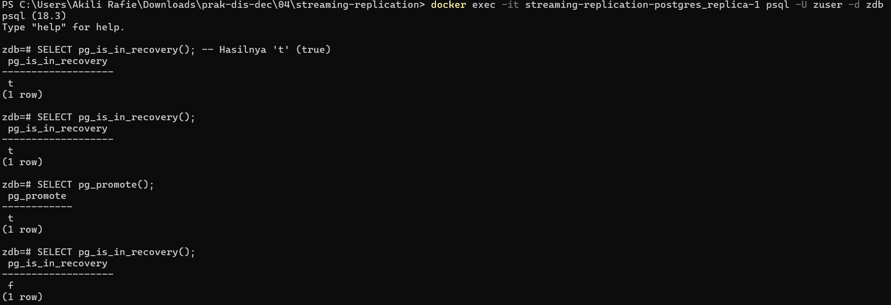
Pembahasan:
Pemeriksaan kondisi server replika menggunakan perintah pg_is_in_recovery(). Ketika hasilnya true, server masih berada dalam mode pemulihan dan berfungsi sebagai server replika. Selanjutnya, perintah pg_promote() digunakan untuk mengubah server replika menjadi server utama yang baru. Setelah proses tersebut dilakukan, pemeriksaan ulang menggunakan pg_is_in_recovery() menghasilkan nilai false. Perubahan ini menunjukkan bahwa server telah keluar dari mode pemulihan dan dapat berfungsi sebagai server utama.

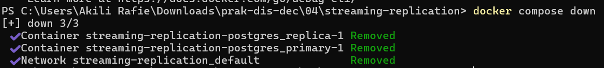
Pembahasan:
Menunjukkan penggunaan perintah docker compose down untuk menghentikan dan menghapus container serta jaringan yang dibuat oleh Docker Compose. Perintah ini digunakan setelah pengujian streaming replication selesai dilakukan. Dengan menjalankan perintah tersebut, lingkungan container yang digunakan dalam praktikum dapat dibersihkan sehingga tidak terus berjalan ketika sudah tidak dibutuhkan.

### 10. Folder ApacheIgnite
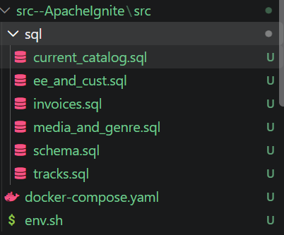
Pembahasan: 
Menunjukkan struktur folder proyek Apache Ignite yang berisi beberapa berkas SQL, seperti current_catalog.sql, ee_and_cust.sql, invoices.sql, media_and_genre.sql, schema.sql, dan tracks.sql. Berkas-berkas tersebut digunakan untuk menyiapkan struktur tabel serta menjalankan perintah pengolahan data pada database. Berkas schema.sql digunakan untuk mendefinisikan struktur database, sedangkan berkas SQL lainnya berisi perintah yang berkaitan dengan tabel dan data tertentu.

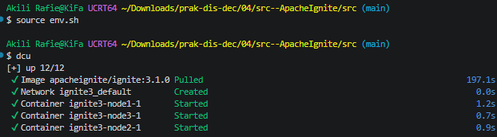
Pembahasan:
Menunjukkan penggunaan perintah source env.sh untuk memuat pengaturan lingkungan yang telah dibuat pada proyek Apache Ignite. Setelah pengaturan dimuat, pengguna menjalankan perintah dcu untuk memulai layanan Docker Compose. Proses tersebut menjalankan tiga container, yaitu ignite3-node1, ignite3-node2, dan ignite3-node3. Ketiga container tersebut berfungsi sebagai node yang akan membentuk satu cluster Apache Ignite.

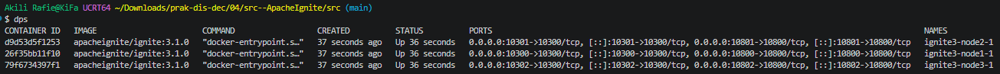
Pembahasan:
Menunjukkan penggunaan perintah dps untuk menampilkan daftar container Docker yang sedang berjalan. Perintah ini merupakan alias dari docker ps yang digunakan untuk melihat nama container, status, port, dan informasi lainnya. Hasil pemeriksaan menampilkan tiga container Apache Ignite yang telah dijalankan pada tahap sebelumnya.

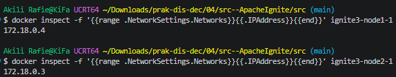
Pembahasan:
Menunjukkan penggunaan perintah docker inspect untuk memeriksa informasi container Apache Ignite, termasuk alamat IP yang digunakan oleh setiap node. Informasi tersebut dapat membantu pengguna memahami koneksi jaringan di antara container yang berjalan dalam lingkungan Docker.

### 11. Apache Ignite
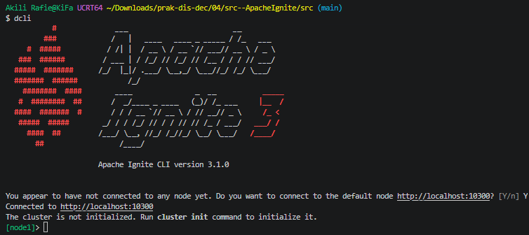
Pembahasan: 
Penggunaan Apache Ignite CLI untuk mengakses dan mengelola layanan Apache Ignite melalui terminal. CLI memungkinkan pengguna menjalankan perintah untuk memeriksa kondisi cluster, mengatur layanan, dan menjalankan perintah SQL.

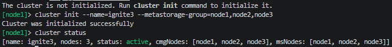
Pembahasan: 
Menunjukkan proses inisialisasi cluster Apache Ignite menggunakan perintah cluster init. Perintah ini digunakan untuk memulai konfigurasi cluster agar node-node yang tersedia dapat bekerja sebagai satu kesatuan. Setelah proses inisialisasi dilakukan, pengguna menjalankan perintah cluster status untuk memeriksa kondisi cluster. Hasil pemeriksaan menunjukkan bahwa cluster ignite3 berstatus aktif dengan tiga node, yaitu node1, node2, dan node3.

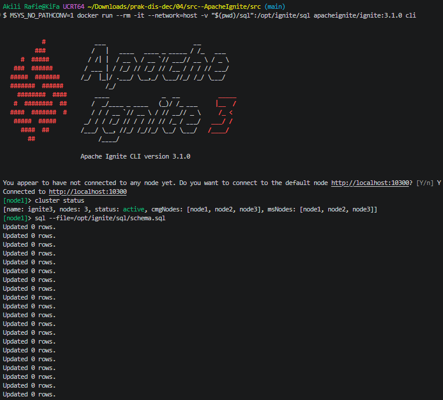
Pembahasan: 
Proses menjalankan perintah SQL melalui Apache Ignite CLI menggunakan berkas SQL yang telah disiapkan. Perintah tersebut digunakan untuk menjalankan instruksi yang terdapat dalam berkas sehingga pengguna tidak perlu memasukkan setiap perintah satu per satu. Pesan Updated 0 rows menunjukkan bahwa perintah berhasil diproses, tetapi tidak ada baris data yang berubah pada operasi tersebut.

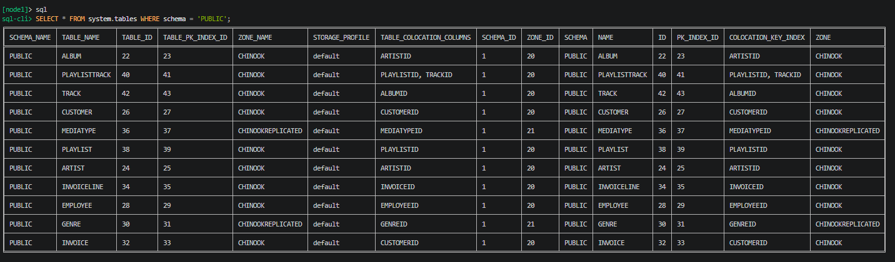
Pembahasan:
Menunjukkan penggunaan perintah SQL untuk memeriksa struktur atau isi tabel pada database Apache Ignite. Perintah SQL membantu pengguna mengambil informasi yang tersimpan dalam tabel sesuai dengan kebutuhan pengujian. Melalui pemeriksaan ini, pengguna dapat mengetahui apakah tabel yang diperlukan sudah tersedia dan apakah data dapat diakses.

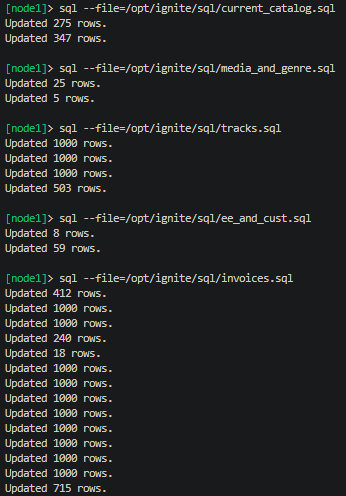
Pembahasan: 
Menunjukkan penggunaan terminal untuk mengakses dan memeriksa layanan Apache Ignite. Melalui terminal, pengguna dapat menjalankan perintah untuk melihat status cluster, memeriksa tabel, dan mengelola database. Tahap ini dilakukan setelah layanan Apache Ignite disiapkan dan cluster mulai dijalankan.

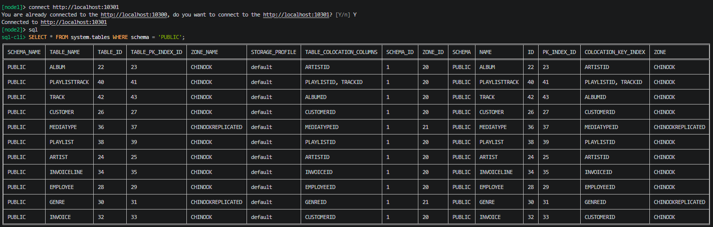
Pembahasan:
Menunjukkan tampilan data node 2 dalam bentuk tabel yang terdiri dari beberapa baris dan kolom. Setiap baris mewakili satu data, sedangkan setiap kolom menunjukkan atribut yang menyimpan informasi tertentu. Tampilan ini memudahkan pengguna untuk membaca dan memeriksa hasil pengolahan data tanpa harus melihat seluruh perintah SQL yang dijalankan. Dan hasilnya sama dengan node 1.

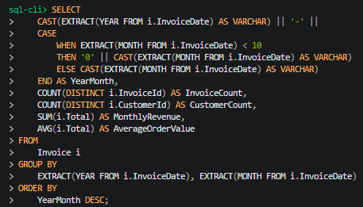
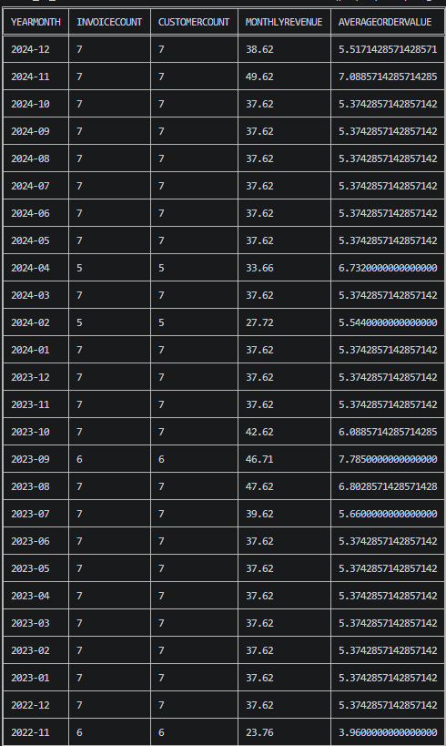
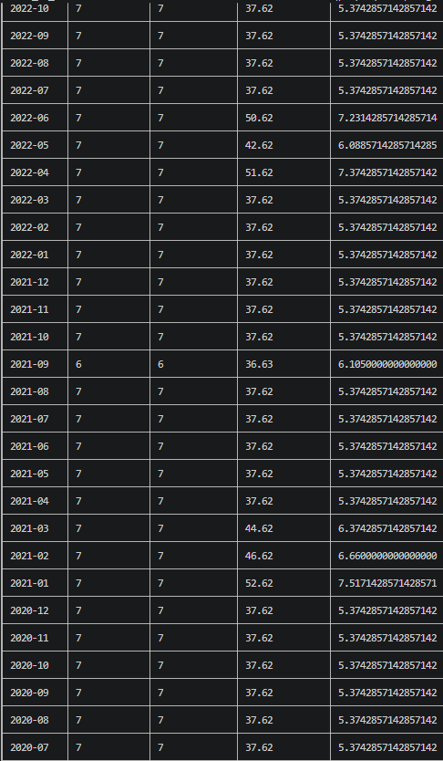
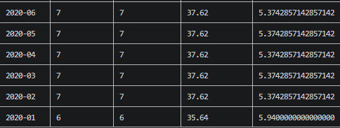
Pembahasan: 
Menunjukkan proses pemeriksaan dan pengolahan data pada Apache Ignite menggunakan perintah SQL. Pada gambar pertama, dilakukan pemeriksaan data dalam tabel untuk memastikan data tersedia dan dapat ditampilkan. Gambar kedua menampilkan query untuk membuat laporan pendapatan bulanan dari tabel Invoice, seperti jumlah faktur, jumlah pelanggan, total pendapatan, dan rata-rata transaksi. Sementara itu, gambar 3 dan 4 menampilkan lanjutan hasil query dalam bentuk tabel yang berisi data lebih lengkap.

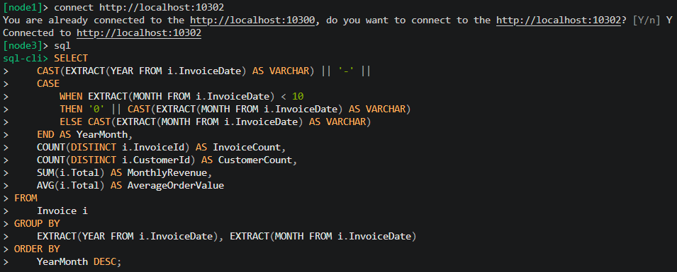

Pembahasan:
Gambar pertama menunjukkan tampilan data node 3 dalam bentuk tabel yang terdiri dari beberapa baris dan kolom. Perintah SQL digunakan untuk menentukan tabel dan data yang ingin diproses sesuai dengan kebutuhan praktikum. Gambar kedua menampilkan query untuk membuat laporan pendapatan bulanan dari tabel Invoice, seperti jumlah faktur, jumlah pelanggan, total pendapatan, dan rata-rata transaksi. Sementara itu, gambar ketiga dan keempat menampilkan lanjutan hasil query dalam bentuk tabel yang berisi data lebih lengkap. Hasil table sama seperti pada node 2.

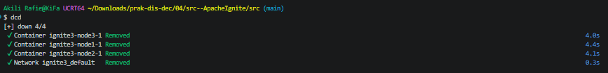
Pembahasan:
Menunjukkan penggunaan perintah docker compose down untuk menghentikan dan menghapus container serta jaringan yang dibuat melalui Docker Compose. Perintah ini digunakan setelah seluruh proses pengujian Apache Ignite selesai dilakukan. Dengan menjalankan perintah tersebut, container yang digunakan selama praktikum tidak lagi berjalan dan jaringan yang dibuat oleh Docker Compose akan dihapus.

---

## Kesimpulan
Kesimpulan dari praktikum ini sistem terdistribusi dapat disiapkan dengan bantuan Docker untuk menjalankan dan mengelola layanan yang dibutuhkan. Struktur tabel serta data dapat dikelola menggunakan SQL, sementara hasil proses dapat diperiksa melalui keluaran terminal maupun tabel. Praktikum ini juga memperkenalkan Apache Ignite sebagai salah satu teknologi untuk pengolahan data terdistribusi. 