# Laporan Praktikum Sistem Terdistribusi dan Terdesentralisasi

---

| Nama | NIM |
| --- | --- |
| Akili Rafie Hendarto | 255410007 |

---
## Minggu 05 - Fault Tolerance
---

## Tujuan Praktikum
Tujuan praktikum adalah untuk memahami konsep Fault Tolerance pada sistem terdistribusi melalui penggunaan load balancing dan failure detection dan mempelajari cara meningkatkan ketersediaan aplikasi menggunakan Docker dan Nginx, menjalankan beberapa instance aplikasi, serta memahami failure detection menggunakan heartbeat, retry mekanisme, dan circuit breaker.

## Dasar Teori
Dasar teori praktikum ini adalah fault Tolerance merupakan kemampuan sistem terdistribusi untuk tetap memberikan layanan ketika terjadi kegagalan pada salah satu komponennya. Salah satu penerapannya adalah load balancing, yaitu pembagian permintaan pengguna ke beberapa replika aplikasi menggunakan Nginx sebagai reverse proxy dengan metode round-robin. Docker dan Docker Compose digunakan untuk menjalankan serta mengelola beberapa container aplikasi secara bersamaan. Selain itu, failure detection digunakan untuk mendeteksi kegagalan layanan melalui protokol heartbeat dengan memeriksa respons komponen dalam waktu tertentu. Mekanisme Retry digunakan untuk mengulangi permintaan ketika terjadi kegagalan koneksi, sedangkan Circuit Breaker berfungsi menghentikan sementara permintaan ketika kegagalan mencapai batas tertentu.

## Pembahasan Praktikum
## 4.1 Load Balancing Aplikasi
### 1. Persiapan

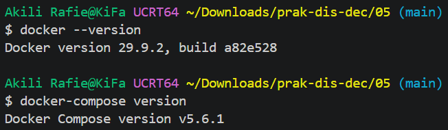
Pembahasan: 
Dilakukan pemeriksaan versi Docker dan Docker Compose melalui terminal menggunakan perintah docker --version dan docker-compose version. Kegiatan ini bertujuan memastikan bahwa Docker dan Docker Compose telah terpasang dengan benar serta dapat digunakan untuk menjalankan dan mengelola aplikasi berbasis container.

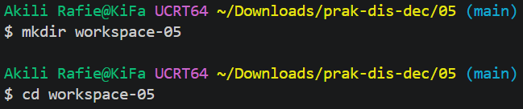
Pembahasan:
Dibuat direktori baru bernama workspace-05 menggunakan perintah mkdir. Selanjutnya, terminal diarahkan ke direktori tersebut menggunakan perintah cd. Langkah ini bertujuan menyiapkan tempat kerja agar seluruh file dan konfigurasi praktikum tersimpan dalam satu folder.

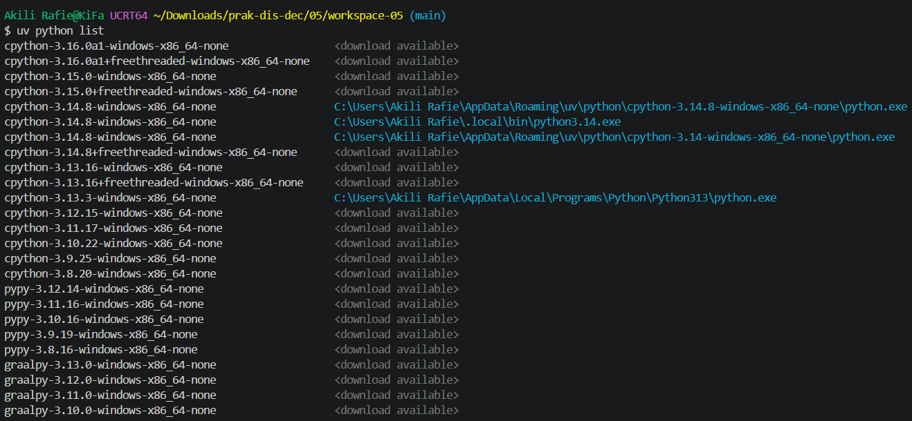
Pembahasan:
Dilakukan pemeriksaan python versi berapa yang digunakan. 

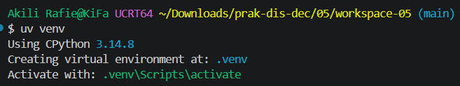
Pembahasan:
Dibuat lingkungan virtual Python menggunakan perintah uv venv. Virtual environment berfungsi memisahkan kebutuhan pustaka setiap proyek sehingga instalasi paket tidak mengganggu lingkungan Python lainnya.

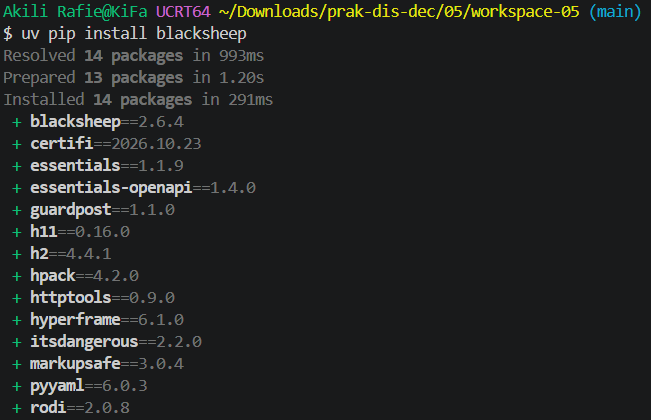
Pembahasan:
Dilakukan instalasi framework BlackSheep menggunakan perintah uv pip install blacksheep. Framework ini digunakan untuk membangun aplikasi web berbasis Python. Proses instalasi juga memasang beberapa dependensi yang diperlukan agar framework dapat berjalan dengan baik.

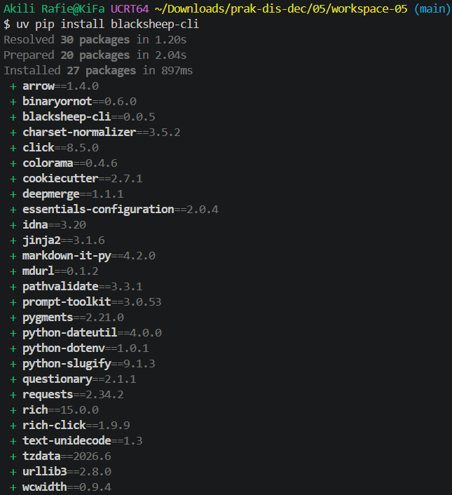
Pembahasan:
Dilakukan instalasi paket tambahan yang dibutuhkan oleh BlackSheep beserta dependensinya. Proses ini bertujuan melengkapi lingkungan pengembangan agar seluruh komponen aplikasi dapat digunakan sesuai kebutuhan.

### 2. Pembuatan Aplikasi Web
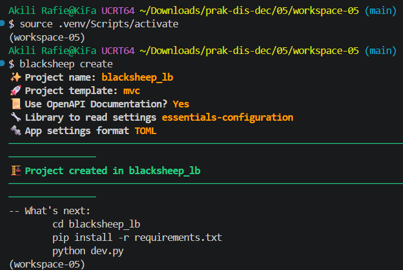
Pembahasan:
Dibuat proyek aplikasi web menggunakan perintah blacksheep create. Dalam proses tersebut, ditentukan nama proyek, template, dokumentasi, dan format konfigurasi aplikasi. Setelah proses selesai, terbentuk struktur proyek yang berisi file dan folder untuk mendukung pengembangan aplikasi.

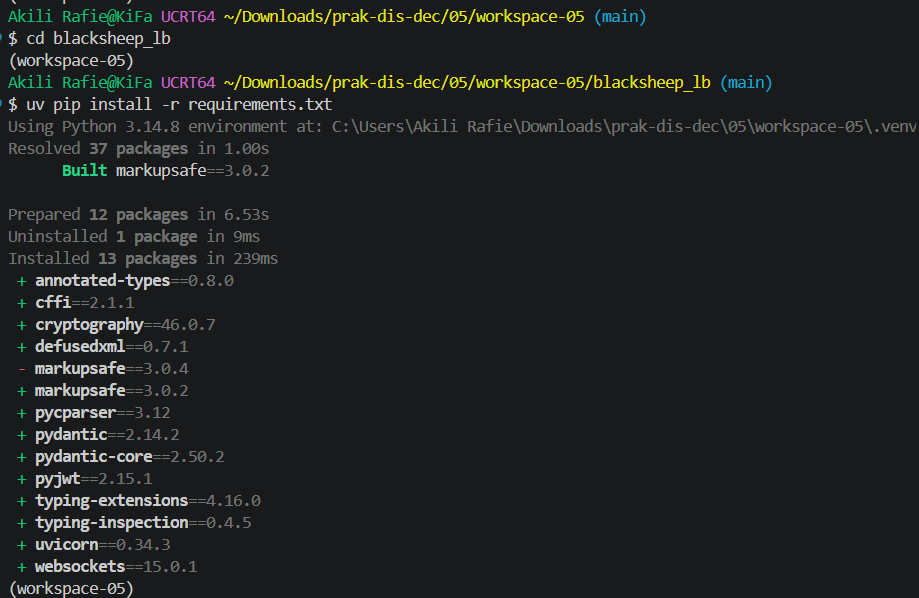
Pembahasan:
Dilakukan instalasi dependensi proyek menggunakan perintah uv pip install -r requirements.txt. Perintah tersebut membaca daftar kebutuhan pustaka dari file requirements.txt dan memasangnya ke dalam virtual environment agar aplikasi dapat dijalankan.

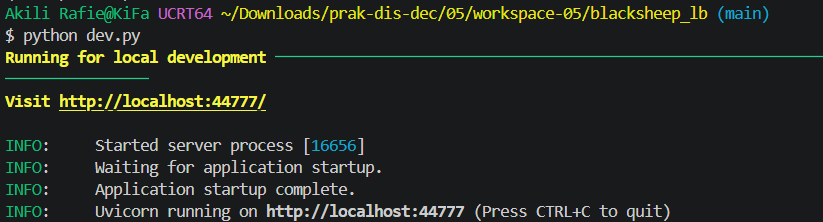
Pembahasan:
Aplikasi web dijalankan menggunakan perintah python dev.py. Proses ini mengaktifkan server pengembangan lokal dan menampilkan alamat akses http://localhost:44777/. Jika klik link tersebut maka akan muncul gambar seperti dibawah ini.

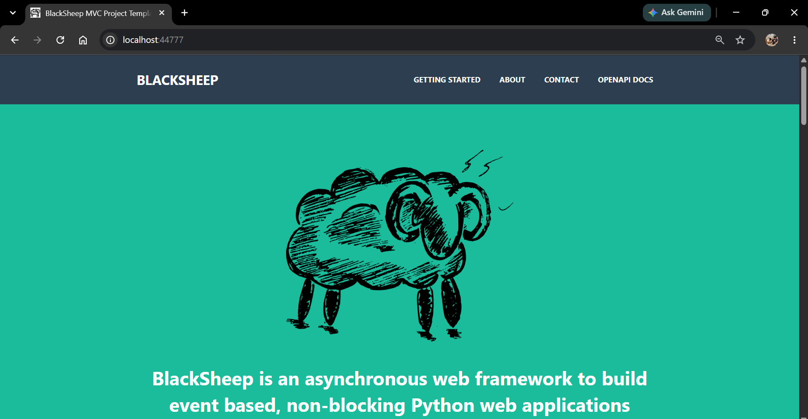
Pembahasan:
Dilakukan pengujian tampilan aplikasi melalui browser dengan mengakses alamat localhost. Hasilnya menunjukkan halaman utama BlackSheep berhasil ditampilkan. Pengujian ini bertujuan memastikan bahwa server telah berjalan dan aplikasi dapat diakses melalui antarmuka web.

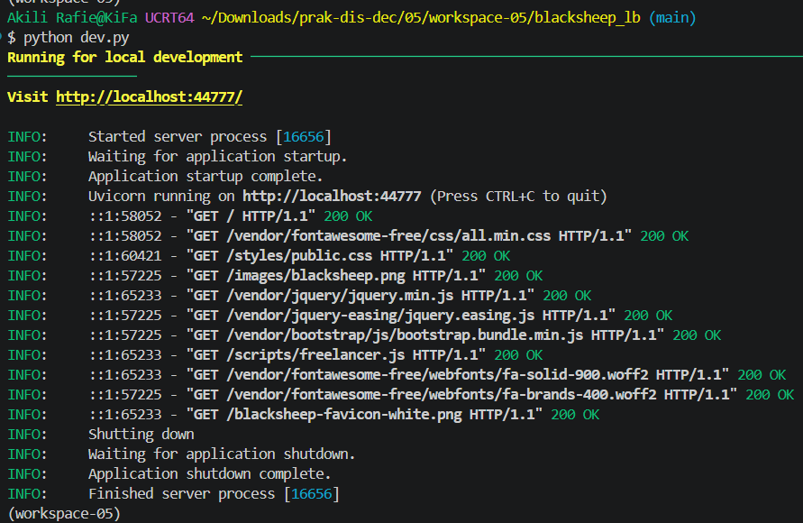
Pembahasan:
Dilakukan pemeriksaan struktur direktori aplikasi menggunakan perintah ls -la. Hasilnya menunjukkan bahwa direktori aplikasi telah memiliki folder dan file yang diperlukan, seperti app, domain, tests, Dockerfile, requirements.txt, dan file konfigurasi lainnya.

### 3. Siapkan Dockerfile dan docker-compose.yml
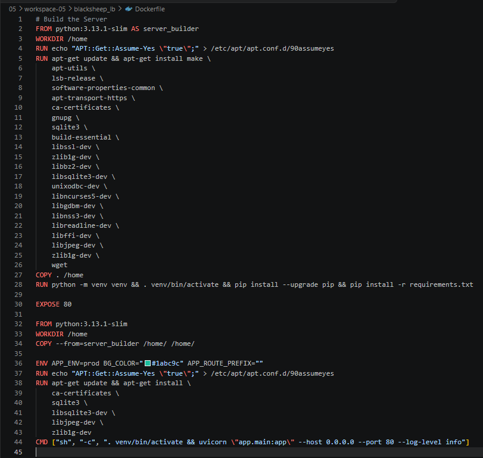
Pembahasan:
Kode Dockerfile tersebut digunakan untuk membangun dan menjalankan aplikasi Python dalam Docker container. Prosesnya meliputi instalasi dependensi, pembuatan virtual environment, penyalinan file proyek, serta pengaturan port 80. Selanjutnya, aplikasi dijalankan menggunakan Uvicorn agar dapat menerima permintaan melalui jaringan container.

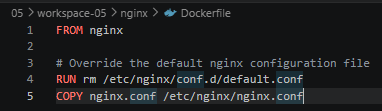
Pembahasan:
Kode tersebut digunakan untuk membuat konfigurasi Dockerfile untuk Nginx. Perintah FROM nginx menentukan image dasar Nginx, RUN rm menghapus konfigurasi bawaan default.conf, sedangkan COPY menyalin file nginx.conf ke dalam container sebagai konfigurasi utama.

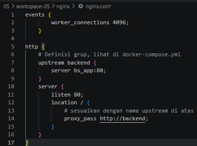
Pembahasan:
Kode tersebut merupakan konfigurasi Nginx yang berfungsi sebagai reverse proxy dan load balancer. Bagian events mengatur jumlah koneksi maksimal sebanyak 4096, sedangkan upstream backend menentukan grup server aplikasi pada bs_app:80. Perintah listen 80 menetapkan port layanan Nginx, sementara proxy_pass meneruskan permintaan pengguna ke server aplikasi melalui backend.

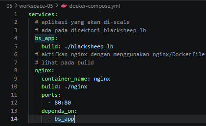
Pembahasan:
Kode tersebut merupakan konfigurasi Docker Compose untuk mengatur layanan aplikasi BlackSheep dan Nginx. Bagian bs_app digunakan untuk membangun container aplikasi dari direktori blacksheep_lb, sedangkan nginx digunakan untuk menjalankan container Nginx dari direktori nginx. Pengaturan ports 80:80 menghubungkan port 80 pada host dengan port 80 dalam container. Sementara itu, depends_on memastikan layanan bs_app dijalankan terlebih dahulu sebelum Nginx.

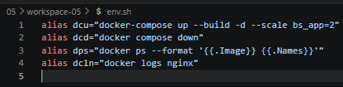
Pembahasan: 
Kode tersebut berisi beberapa alias untuk mempermudah penggunaan perintah Docker melalui terminal. Alias dcu digunakan untuk membangun dan menjalankan container dengan dua replika aplikasi bs_app. Alias dcd digunakan untuk menghentikan dan menghapus container. Alias dps digunakan untuk menampilkan daftar container beserta nama dan image yang digunakan, sedangkan dcln digunakan untuk melihat log aktivitas Nginx.

### 4. Jalankan Docker Compose
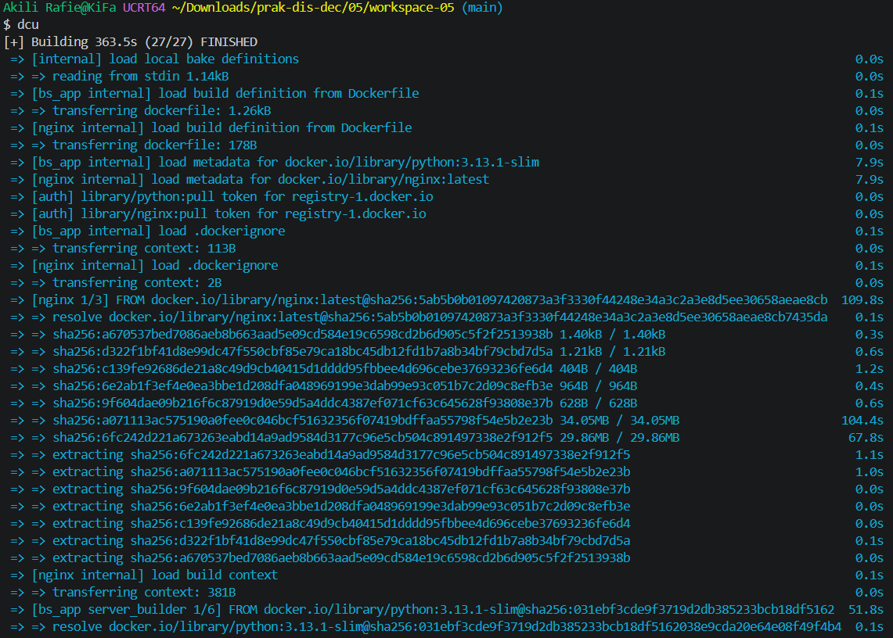
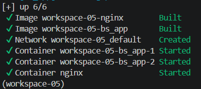
Pembahasan:
dilakukan pemeriksaan konfigurasi Docker Compose yang digunakan untuk menjalankan beberapa container dalam satu lingkungan kerja. Konfigurasi tersebut mengatur layanan aplikasi, jaringan, dan komponen pendukung sehingga setiap layanan dapat saling terhubung sesuai kebutuhan.

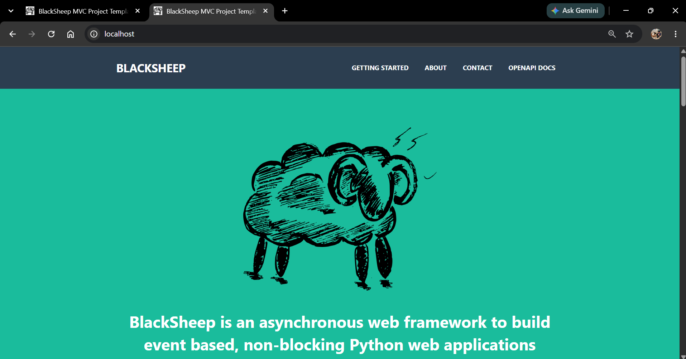
Pembahasan:
Dilakukan pengamatan kembali terhadap tampilan aplikasi BlackSheep melalui browser. Halaman aplikasi berhasil ditampilkan sehingga dapat diketahui bahwa konfigurasi dan proses pengembangan sebelumnya telah menghasilkan aplikasi web yang dapat diakses.

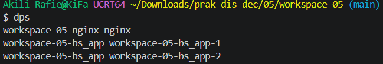
Pembahasan:
dijalankan layanan menggunakan Docker Compose. Hasil proses menunjukkan bahwa image berhasil dibangun, network berhasil dibuat, serta beberapa container aplikasi dan Nginx berhasil dijalankan.

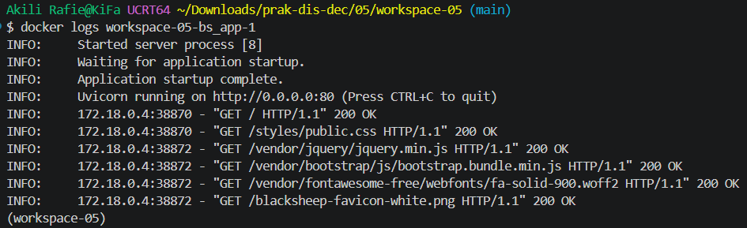
Pembahasan:
Dilakukan pemeriksaan container yang sedang berjalan menggunakan perintah Docker. Hasilnya menunjukkan bahwa container aplikasi dan Nginx berada dalam kondisi aktif.

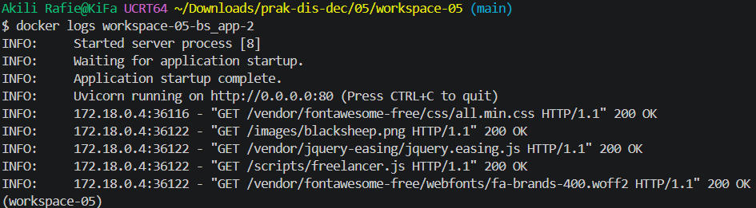
Pembahasan:
Dilakukan pengujian aplikasi yang berjalan melalui lingkungan container. Hasil terminal menunjukkan bahwa server berhasil aktif dan menerima permintaan HTTP dari pengguna.

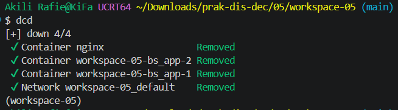
Pembahasan:
Dilakukan penghentian dan penghapusan layanan menggunakan perintah Docker Compose. Hasilnya menunjukkan bahwa container aplikasi, container Nginx, dan network berhasil dihapus. Langkah ini bertujuan membersihkan lingkungan container setelah proses pengujian selesai.

## 4.2 Failure Detection
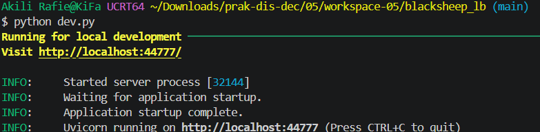
Pembahasan:
Aplikasi kembali dijalankan secara langsung menggunakan perintah python dev.py. Server berhasil aktif dan menampilkan alamat localhost. Kegiatan ini menunjukkan bahwa aplikasi tetap dapat dijalankan melalui lingkungan virtual Python tanpa harus menggunakan Docker Compose.

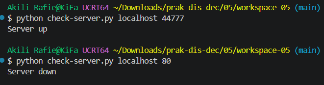
Pembahasan:
Dilakukan pemeriksaan kondisi server menggunakan program check-server.py. Pengujian dilakukan pada alamat localhost dengan port 44777 dan port 80. Hasilnya menunjukkan bahwa server pada port 44777 berstatus aktif, sedangkan port 80 tidak dapat diakses.

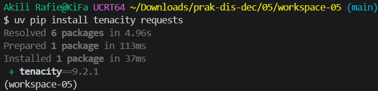
Pembahasan:
Dilakukan instalasi pustaka Python bernama Tenacity dan Requests menggunakan perintah uv pip install tenacity requests. Tenacity digunakan untuk mengatur percobaan ulang ketika suatu proses mengalami kegagalan, sedangkan Requests digunakan untuk melakukan komunikasi HTTP.

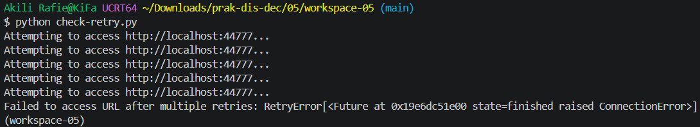
Pembahasan:
Dilakukan pengujian mekanisme retry menggunakan program check-retry.py. Hasilnya menunjukkan bahwa program mencoba mengakses server secara berulang ketika permintaan belum berhasil.

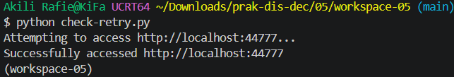
Pembahasan:
Dilakukan pengujian ulang program retry menggunakan perintah python check-retry.py. Hasilnya menunjukkan bahwa program berhasil mengakses alamat localhost pada port 44777. Hal ini membuktikan bahwa mekanisme retry dapat membantu program memperoleh koneksi kembali setelah mengalami kegagalan akses.

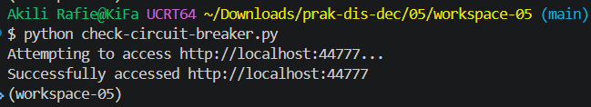
Pembahasan: 
Dilakukan pengujian mekanisme Circuit Breaker menggunakan program check-circuit-breaker.py. Hasilnya menunjukkan bahwa program berhasil mengakses server pada alamat localhost. Pengujian ini bertujuan memahami penerapan Circuit Breaker dalam pengelolaan komunikasi aplikasi, yaitu mengendalikan permintaan ketika layanan mengalami gangguan agar kegagalan tidak terus berulang.

---

## Kesimpulan
Kesimpulan dari praktikum ini memberikan pemahaman mengenai penggunaan Docker, Docker Compose, dan framework BlackSheep dalam pengembangan aplikasi web. Dimulai dari instalasi dan konfigurasi lingkungan Python, pembuatan proyek aplikasi, hingga menjalankan dan menguji aplikasi melalui browser maupun container Docker. Selain itu, praktikum ini juga mempelajari penggunaan pustaka Tenacity dan Requests untuk menerapkan mekanisme Retry serta Circuit Breaker dalam menangani gangguan komunikasi pada aplikasi. 