# Laporan Praktikum Sistem Terdistribusi dan Terdesentralisasi

---

| Nama | NIM |
| --- | --- |
| Akili Rafie Hendarto | 255410007 |

---
## Minggu 06 - Distributed File System - HDFS
---

## Tujuan Praktikum
Tujuan praktikum adalah mahasiswa mampu memasang, mengonfigurasi, dan mengoperasikan Apache Hadoop Distributed File System (HDFS) dalam mode pseudo-distributed, serta memahami cara kerja penyimpanan data pada sistem berkas terdistribusi.

## Dasar Teori
Dasar teori praktikum ini adalah yaitu penyimpanan yang menyebarkan data ke banyak node namun tampil sebagai satu sistem bagi pengguna. Apache Hadoop adalah kerangka kerja berbasis Java untuk pengolahan data besar, dengan HDFS sebagai komponen penyimpanannya. HDFS memakai arsitektur master/worker: NameNode menyimpan metadata, DataNode menyimpan blok data, dan SecondaryNameNode membantu checkpoint. Berkas dipecah menjadi blok yang direplikasi agar tahan kegagalan (dfs.replication bernilai 1 pada mode pseudo-distributed satu node). Hadoop 3.5.0 membutuhkan JDK 17 dan dikonfigurasi lewat core-site.xml, hdfs-site.xml, dan hadoop-env.sh. NameNode diformat sekali, daemon dijalankan dengan start-dfs.sh lewat SSH tanpa password (dibantu pdsh), lalu dipantau dengan jps dan web UI port 9870, serta berkas dikelola dengan hdfs dfs.

## Pembahasan Praktikum
## 1. Unduh Apache Hadoop

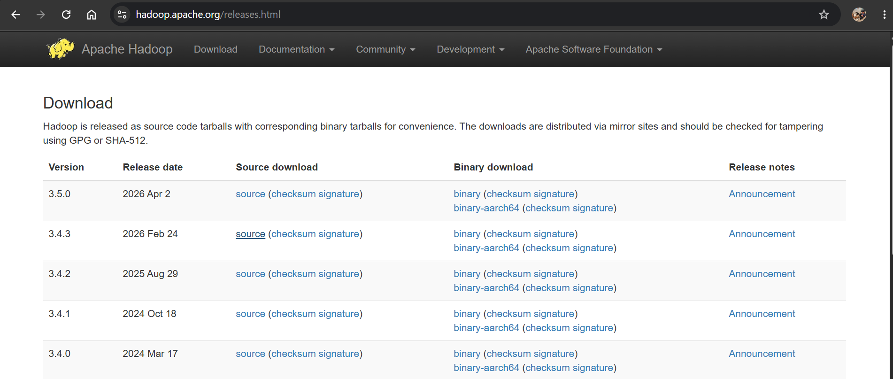
Pembahasan: 
Gambar tersebut menampilkan halaman unduhan resmi Apache Hadoop (hadoop.apache.org/releases.html) yang menyajikan daftar versi perangkat lunak yang dirilis beserta tanggal rilis, tautan unduhan kode sumber (source), unduhan biner (binary dan binary-aarch64) lengkap dengan tanda tangan checksum, serta tautan ke catatan rilis (announcement), dengan versi terbaru yang tercantum adalah 3.5.0.

---

## 2. Intalasi Apache Hadoop
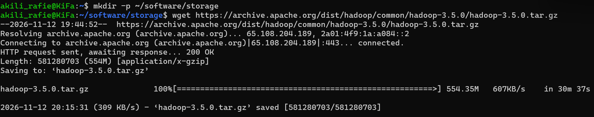
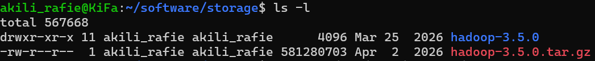
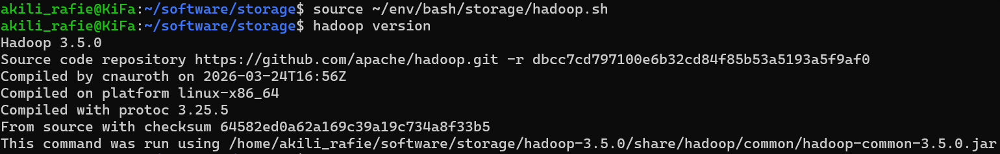
Pembahasan:
Mengidentifikasi versi stabil terbaru yaitu 3.5.0, yang kemudian dilanjutkan dengan pembuatan direktori penyimpanan khusus di dalam sistem Linux pengguna dan pengunduhan file arsip terkompresi hadoop-3.5.0.tar.gz berukuran sekitar 554 megabita menggunakan utilitas baris perintah wget. Proses berlanjut dengan pemeriksaan isi direktori menggunakan perintah ls -l yang memperlihatkan keberadaan direktori hasil ekstraksi hadoop-3.5.0 beserta file arsip aslinya, sebelum akhirnya diakhiri dengan pemuatan skrip konfigurasi variabel lingkungan melalui perintah source dan pengeksekusian perintah hadoop version guna memastikan bahwa kerangka kerja Apache Hadoop versi 3.5.0 telah terpasang dengan benar.

---

## 3. Instalasi PDSH
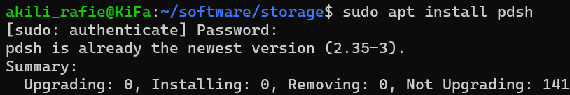
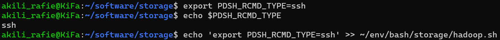
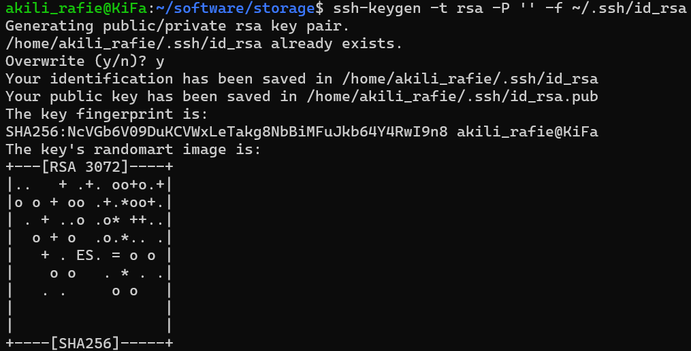
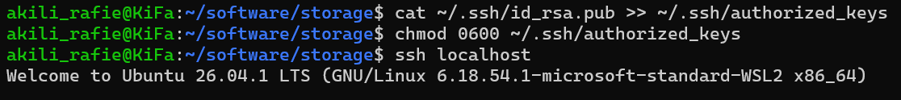
Pembahasan:
Tahapan konfigurasi awal pendukung untuk Apache Hadoop, yang diawali dengan instalasi dan konfigurasi utilitas pdsh untuk manajemen eksekusi jarak jauh, pembuatan serta pengaturan kunci autentikasi SSH (ssh-keygen), hingga penyalinan kunci publik ke authorized_keys guna memastikan koneksi SSH tanpa sandi ke localhost dapat berfungsi dengan sukses sebelum menjalankan layanan Hadoop.

---

## 4. Konfigurasi Apache Hadoop
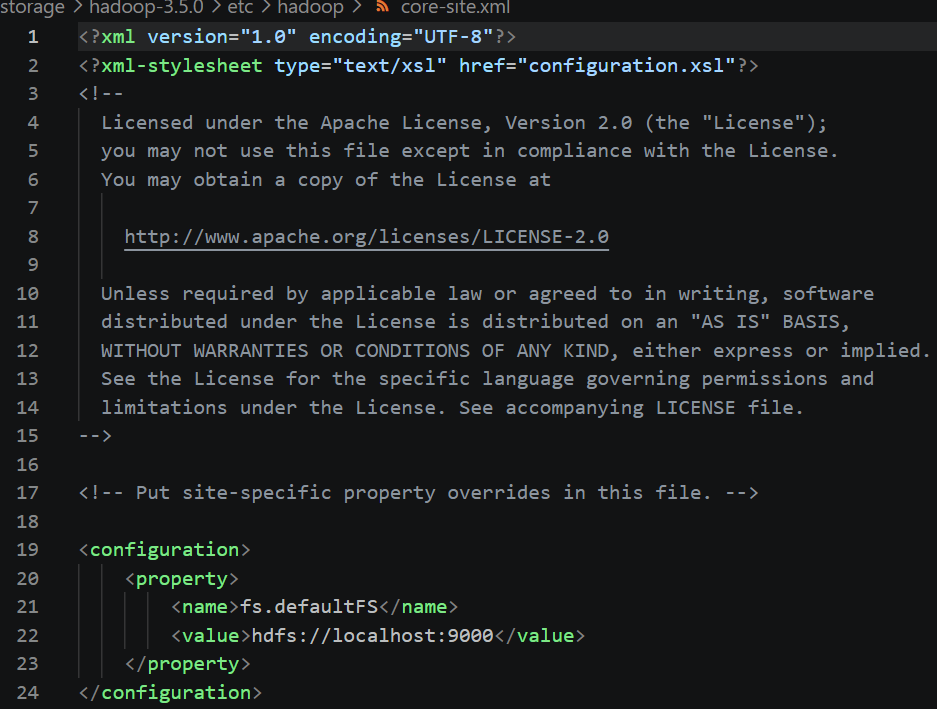
Pembahasan:
Gambar tersebut menampilkan isi berkas konfigurasi core-site.xml pada direktori Apache Hadoop 3.5.0 yang mendefinisikan properti fs.defaultFS dengan nilai hdfs://localhost:9000, yang berfungsi untuk mengatur alamat serta porta NameNode agar sistem mengenali bahwa Hadoop Distributed File System (HDFS) berjalan secara lokal di mesin tersebut.

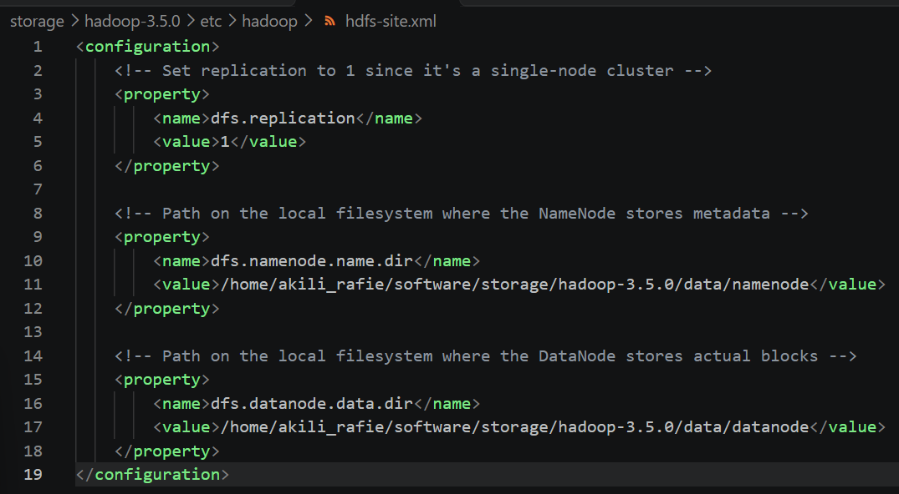
Pembahasan:
Gambar tersebut menampilkan isi berkas konfigurasi hdfs-site.xml Apache Hadoop yang mengatur parameter penyimpanan sistem berkas terdistribusi, di mana nilai dfs.replication ditetapkan sebesar 1 karena dijalankan pada klaster node tunggal, serta mendefinisikan jalur direktori lokal secara spesifik untuk penyimpanan metadata NameNode dan penyimpanan blok data DataNode pada sistem.

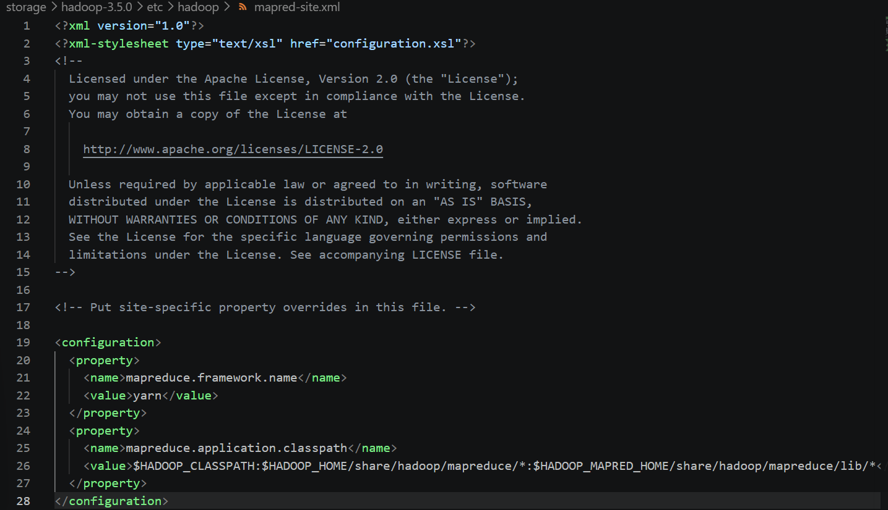
Pembahasan:
Gambar tersebut menampilkan berkas konfigurasi mapred-site.xml yang telah diperbarui dengan menambahkan parameter properti mapreduce.framework.name yang diatur bernilai yarn serta mapreduce.application.classpath untuk mendefinisikan jalur classpath MapReduce agar kerangka kerja dapat berjalan dan terintegrasi dengan baik menggunakan manajemen sumber daya YARN.

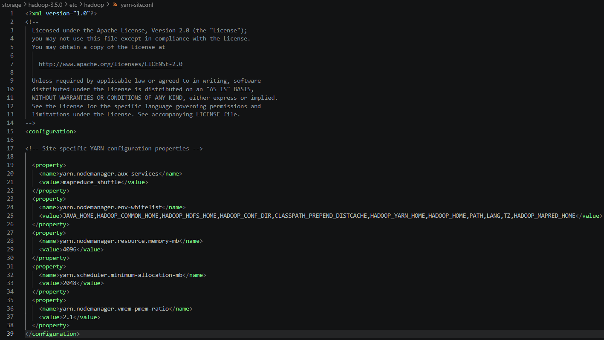
Pembahasan:
Gambar tersebut menampilkan berkas konfigurasi yarn-site.xml yang telah diisi dengan parameter manajemen sumber daya YARN secara lengkap, mencakup pengaturan layanan tambahan mapreduce_shuffle, daftar putih variabel lingkungan, alokasi memori NodeManager sebesar 4096 MB, batas alokasi minimum scheduler sebesar 2048 MB, serta rasio memori virtual dan fisik sebesar 2.1 agar pengelolaan tugas dapat berjalan stabil pada klaster Hadoop.

---

## 5. Format Namenode
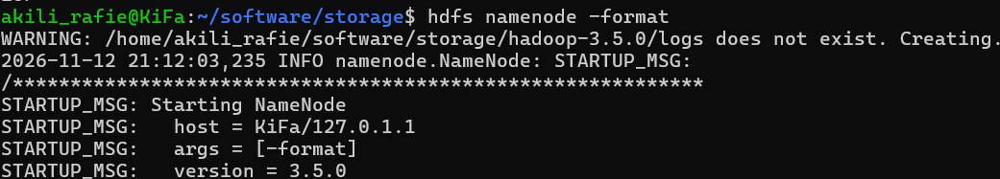
Pembahasan:
Gambar tersebut menampilkan proses eksekusi perintah hdfs namenode -format di terminal untuk melakukan pemformatan awal pada NameNode Apache Hadoop versi 3.5.0, di mana sistem secara otomatis membuat direktori log yang belum tersedia sebelum melanjutkan inisialisasi layanan pada host lokal.

---

## 6. Daemon untuk hdfs
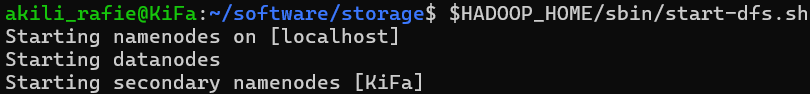
Pembahasan:
Terminal menjalankan perintah $HADOOP_HOME/sbin/start-dfs.sh untuk memulai layanan HDFS Apache Hadoop, yang secara berurutan menghidupkan NameNode pada komputer lokal, DataNode, serta Secondary NameNode.

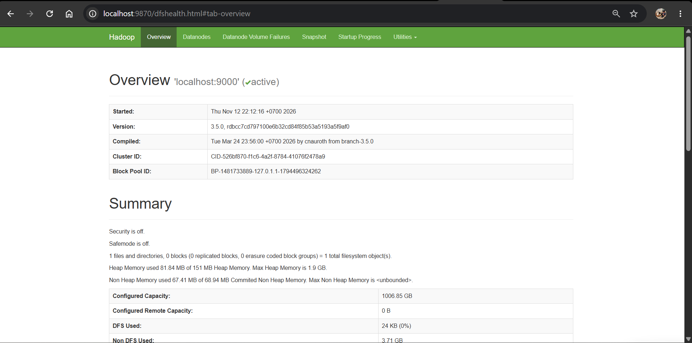
Pembahasan:
Antarmuka web Hadoop yang diakses melalui peramban pada alamat localhost:9870 menampilkan ringkasan status aktif klaster HDFS versi 3.5.0 beserta informasi kapasitas penyimpanan yang dikonfigurasi.

---

## 7. Tugas
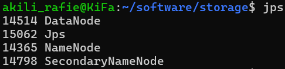
Pembahasan:
Gambar tersebut menampilkan hasil dari perintah jps di terminal Linux yang menunjukkan daftar proses Java yang sedang berjalan, di mana terdapat layanan inti Apache Hadoop yaitu DataNode, NameNode, dan SecondaryNameNode yang aktif bersama proses Jps itu sendiri, menandakan bahwa seluruh layanan dasar HDFS pada klaster lokal Anda telah berjalan dengan sukses.

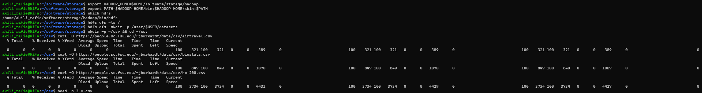
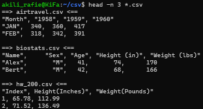
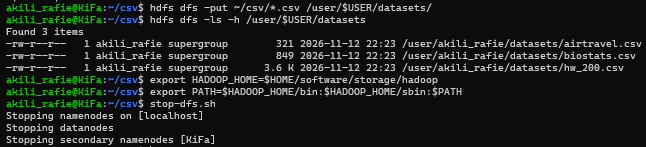
Pembahasan:
Diawali dengan konfigurasi variabel lingkungan Hadoop (HADOOP_HOME dan PATH) serta pengujian perintah hdfs untuk memastikan ketersediaannya di sistem, yang dilanjutkan dengan pembuatan direktori penyimpanan dataset di dalam HDFS melalui perintah hdfs dfs -mkdir. Pengguna kemudian mengunduh tiga file dataset sampel berformat CSV—yaitu airtravel.csv, biostats.csv, dan hw_200.csv—dari sumber eksternal menggunakan utilitas curl, serta melakukan pratinjau struktur baris awal menggunakan perintah head untuk memeriksa validitas data teks yang baru diunduh. Setelah data lokal siap, seluruh file tersebut diunggah ke dalam sistem berkas terdistribusi HDFS menggunakan perintah hdfs dfs -put, diikuti dengan verifikasi daftar berkas yang tersimpan lewat perintah hdfs dfs -ls untuk memastikan proses unggah berjalan sukses. Rangkaian aktivitas ini ditutup dengan pemuatan kembali variabel lingkungan Hadoop dan eksekusi skrip penghentian layanan stop-dfs.sh guna mematikan proses NameNode, DataNode, dan Secondary NameNode yang sebelumnya aktif di latar belakang sistem.

---

## Kesimpulan
Kesimpulan dari praktikum ini adalah Apache Hadoop 3.5.0 berhasil dipasang dalam mode pseudo-distributed sehingga HDFS berjalan dengan NameNode, DataNode, dan SecondaryNameNode (terverifikasi lewat jps dan web UI port 9870). Keberhasilannya bergantung pada JDK 17, SSH tanpa password, konfigurasi yang benar, dan urutan PATH yang tepat (kendala hdfs yang tertukar teratasi dengan memeriksa PATH).