# Laporan Praktikum Sistem Terdistribusi dan Terdesentralisasi

---

| Nama | NIM |
| --- | --- |
| Akili Rafie Hendarto | 255410007 |

---
## Minggu 07 - Cloud Computing 
---

## Tujuan Praktikum
Tujuan praktikum adalah mahasiswa memahami konsep kontainerisasi aplikasi web Python (Flask) menggunakan Docker pada lingkungan WSL 2 dan mahasiswa diharapkan mampu mengintegrasikan WSL 2 dengan Docker Desktop, menyusun Dockerfile untuk aplikasi flaskr, membangun dan mengelola image, serta menjalankan aplikasi dalam container dengan pemetaan port agar dapat diakses dari host.

## Dasar Teori
Dasar teori praktikum ini adalah Kontainerisasi adalah metode pengemasan aplikasi beserta seluruh dependensi dan konfigurasinya ke dalam unit terisolasi bernama container yang berbagi kernel dengan sistem operasi host, sehingga lebih ringan dan konsisten dibanding virtual machine. Dalam Docker, proses ini dijalankan menggunakan arsitektur client-server melalui Dockerfile untuk membangun image siap pakai, serta menjalankan image tersebut menjadi container aktif. Pada aplikasi web berbasis Flask seperti flaskr, kode proyek dikemas ke dalam image, diinstal dependensinya, diinisialisasi basis datanya, lalu dijalankan pada alamat 0.0.0.0 dan port tertentu agar dapat diakses dari luar container. Dengan mengaktifkan integrasi WSL 2 pada Docker Desktop, perintah seperti docker build, docker images, docker rmi, dan docker run dapat dijalankan langsung dari terminal Linux untuk mengelola siklus hidup aplikasi secara utuh.

## Pembahasan Praktikum
# Tugas 0: Cloud Computing (SaaS, PaaS, dan IaaS)

## 1. Contoh Vendor/Komunitas (Masing-Masing 1)

* **SaaS (*Software as a Service*):** **Google Workspace** (seperti Gmail, Google Docs, dan Google Drive).
* **PaaS (*Platform as a Service*):** **Heroku** (atau **Render**).
* **IaaS (*Infrastructure as a Service*):** **Amazon Web Services (AWS)** (seperti layanan AWS EC2 dan EBS).

---

## 2. Uraian Layanan (*Service*) pada Tiap Kategori XaaS

### SaaS — Google Workspace
Layanan yang diberikan adalah **aplikasi perangkat lunak siap pakai** yang diakses langsung melalui peramban web tanpa perlu menginstal atau mengelola server, sistem operasi, maupun pembaruan kode aplikasi. Pengguna tinggal masuk dan memakai fitur kolaborasi dokumen, email, penyimpanan awan, dan rapat daring, sementara penyedia mengelola seluruh infrastruktur dan pemeliharaannya.

### PaaS — Heroku
Layanan yang diberikan adalah **lingkungan pengembangan dan *deployment* platform** yang membungkus infrastruktur server dan sistem operasi. Pengembang cukup mengunggah kode aplikasi (misalnya Python/Flask, Node.js, atau Ruby), lalu platform menangani *runtime*, *build*, *scaling* dasar, manajemen *routing*, dan integrasi *add-on* basis data tanpa pengembang perlu mengonfigurasi OS atau *patch* server secara manual.

### IaaS — Amazon Web Services (AWS)
Layanan yang diberikan adalah **sumber daya komputasi infrastruktur dasar secara *on-demand***, seperti mesin virtual (*compute instances*), penyimpanan blok/objek (*storage*), dan jaringan virtual (*VPC*, *subnet*, *firewall*/keamanan jaringan). Pengguna memiliki kendali penuh atas sistem operasi, *runtime*, *middleware*, hingga aplikasi yang dijalankan di atas infrastruktur virtual tersebut.

---

## 3. Visualisasi Arsitektur Umum XaaS

Secara umum, perbedaan utama **IaaS**, **PaaS**, dan **SaaS** terletak pada **lapisan mana yang dikelola oleh Penyedia Layanan (*Provider*)** versus **lapisan mana yang dikelola oleh Pengguna (*User/Developer*)**:

```text
+-----------------------------------------------------------------------------+
|                        LAPISAN ARSITEKTUR XaaS                              |
+------------------------+------------------------+---------------------------+
|          IaaS          |          PaaS          |           SaaS            |
|   (Contoh: AWS EC2)    |   (Contoh: Heroku)     | (Contoh: Google Workspace)|
+------------------------+------------------------+---------------------------+
| Applications & Data    | Applications & Data    | [Dikelola Provider]       |
| Runtime & Middleware     | [Dikelola Provider]    | [Dikelola Provider]       |
| Operating System       | [Dikelola Provider]    | [Dikelola Provider]       |
+------------------------+------------------------+---------------------------+
| Virtualization         | Virtualization         | Virtualization            |
| Servers & Storage      | Servers & Storage      | Servers & Storage         |
| Networking             | Networking             | Networking                |
+------------------------+------------------------+---------------------------+
```

Keterangan:
- Bagian TANPA label "[Dikelola Provider]" = Dikelola oleh User / Developer
- Bagian "[Dikelola Provider]"           = Dikelola oleh Vendor / Provider


## 1. Clone flask

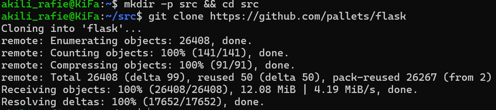
Pembahasan: 
Membuat direktori src lalu masuk ke dalamnya menggunakan perintah mkdir -p src && cd src, kemudian menyalin (meng-clone) repositori kode sumber resmi Flask dari GitHub ke komputer lokal menggunakan perintah git clone https://github.com/pallets/flask agar dapat dipelajari, dimodifikasi, atau dijalankan secara lokal.

---

## 2. Salin & Cek Folder Proyek Flask
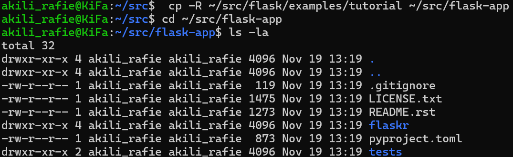
Pembahasan:
Menyalin folder proyek contoh tutorial Flask ke direktori baru bernama flask-app menggunakan cp -R ~/src/flask/examples/tutorial ~/src/flask-app, berpindah ke folder tersebut dengan cd ~/src/flask-app, lalu memeriksa isi file dan direktori di dalamnya menggunakan ls -la yang menampilkan struktur proyek seperti flaskr, tests, pyproject.toml, README.rst, dan LICENSE.txt sebagai workspace kerja proyek aplikasi Flask.

---

## 3. Buat & Aktifkan Virtual Environment
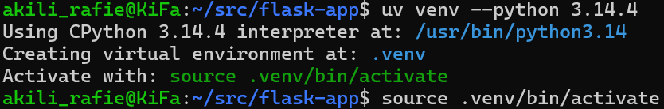
Pembahasan:
Pembuatan dan pengaktifan lingkungan virtual Python di dalam folder proyek menggunakan uv venv --python 3.14.4 yang memanfaatkan interpreter CPython 3.14.4 di .venv, lalu dilanjutkan dengan perintah source .venv/bin/activate agar dependensi dan eksekusi proyek Flask terisolasi rapi di lingkungan virtual tersebut.

---

## 4. Install Paket
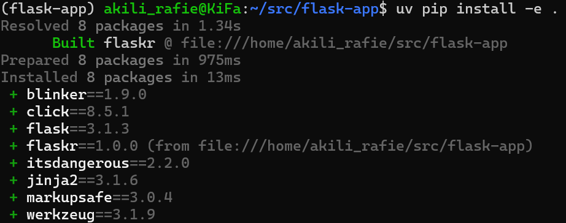
Pembahasan:
Menampilkan instalasi paket aplikasi flaskr secara editable (-e .) beserta dependensinya seperti Flask, Jinja2, Werkzeug, Click, Blinker, ItsDangerous, dan MarkupSafe ke dalam lingkungan virtual menggunakan uv pip install -e . agar kode proyek dapat langsung dijalankan dan perubahan kodenya langsung terbaca tanpa instalasi ulang.

---

## 5. Jalan Server Flask dan Hasil Web
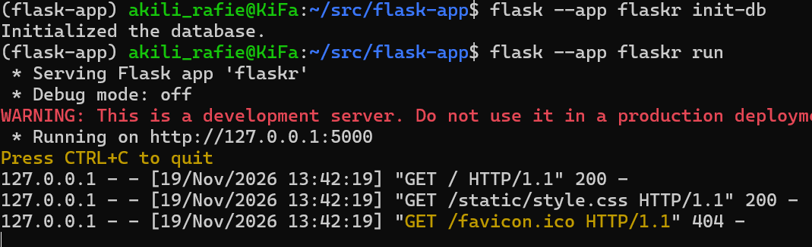
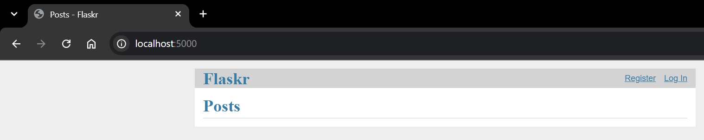
Pembahasan:
Kedua gambar ini menunjukkan tahap akhir menjalankan dan menguji aplikasi Flaskr secara lokal, di mana gambar pertama memperlihatkan proses inisialisasi basis data lewat flask --app flaskr init-db serta menyalakan server pengembangan di [http://127.0.0.1:5000](http://127.0.0.1:5000) menggunakan flask --app flaskr run lengkap dengan log permintaan HTTP, sedangkan gambar kedua menampilkan hasil akses alamat localhost:5000 di peramban yang memuat halaman utama Posts Flaskr beserta opsi Register dan Log In.

---

## 6. Isi file Dockerfile
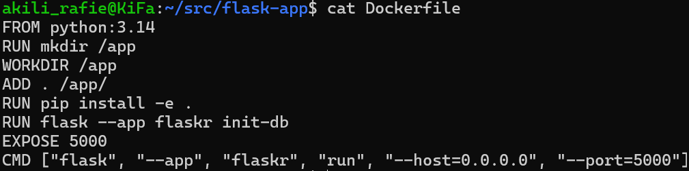
Pembahasan:
Gambar tersebut menampilkan isi file Dockerfile di dalam direktori proyek flask-app menggunakan perintah cat Dockerfile, yang mendefinisikan langkah pembuatan image Docker berbasis python:3.14 dengan membuat folder /app, menjadikannya direktori kerja, menyalin berkas proyek, menginstal paket flaskr secara editable lewat pip install -e ., menginisialisasi basis data dengan flask --app flaskr init-db, membuka port 5000, serta menjalankan aplikasi Flask pada 0.0.0.0:5000 saat kontainer menyala agar aplikasi dapat dikontainerisasi dan dijalankan secara konsisten di lingkungan mana pun.

---

## 7. Build Docker
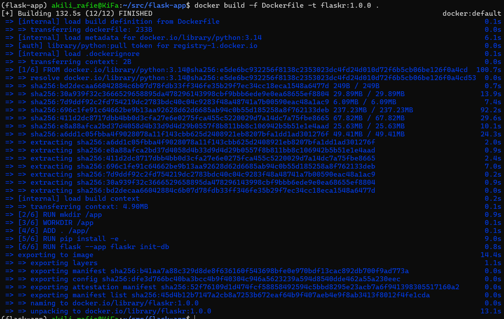
Pembahasan:
Menampilkan proses membangun Docker image bernama flaskr:1.0.0 berdasarkan konfigurasi Dockerfile menggunakan perintah docker build -f Dockerfile -t flaskr:1.0.0 ., mulai dari mengunduh dan mengekstrak base image python:3.14, menyalin proyek ke /app, menginstal dependensi dan aplikasi flaskr

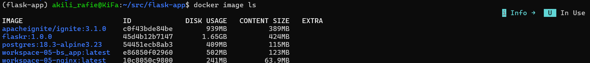
Pembahasan:
Menampilkan daftar Docker image yang tersimpan di mesin lokal menggunakan perintah docker image ls, di mana image flaskr:1.0.0 (ID 45d4b12b7147) sudah berhasil terdaftar berdampingan dengan image lain seperti apacheignite/ignite:3.1.0, postgres:18.3-alpine3.23, workspace-05-bs_app:latest, dan workspace-05-nginx:latest, menandakan image aplikasi Flask sudah siap untuk dijalankan sebagai kontainer.

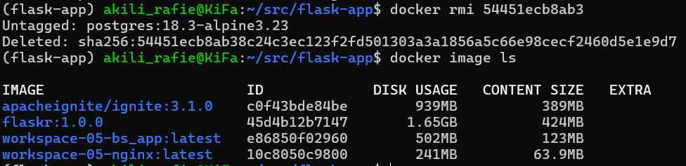
Pembahasan:
Menampilkan proses penghapusan Docker image postgres:18.3-alpine3.23 (ID 54451ecb8ab3) menggunakan perintah docker rmi 54451ecb8ab3 untuk membersihkan ruang penyimpanan, lalu dilanjutkan dengan memeriksa kembali daftar image lokal lewat docker image ls guna memastikan image tersebut sudah terhapus sementara image lainnya termasuk flaskr:1.0.0 tetap tersimpan.

---

## 8. 
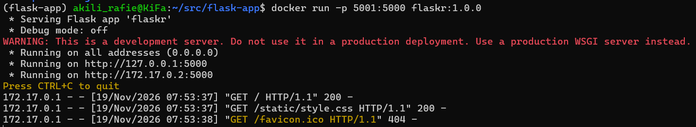
Pembahasan:
Menampilkan proses menjalankan aplikasi Flaskr di dalam kontainer Docker menggunakan perintah docker run -p 5001:5000 flaskr:1.0.0 yang memetakan port 5001 pada mesin host ke port 5000 di dalam kontainer, sehingga aplikasi Flask berjalan di dalam lingkungan terisolasi dan dapat diakses melalui port 5001 dengan log permintaan HTTP yang masuk ke server.

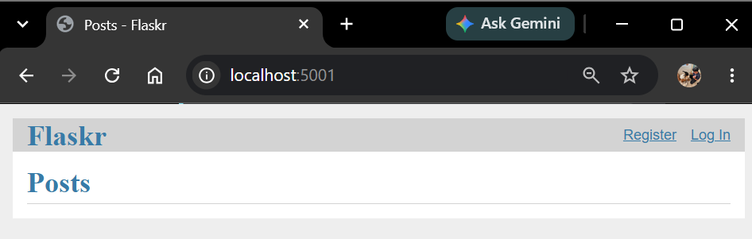
Pembahasan:
Menampilkan tampilan aplikasi web Flaskr di peramban dengan mengakses alamat localhost:5001 yang terhubung ke kontainer Docker, memperlihatkan halaman utama Posts beserta tombol Register dan Log In sebagai bukti bahwa aplikasi Flask yang berjalan di dalam kontainer dapat diakses dengan baik dari host melalui port yang dipetakan.

---

## Kesimpulan
Kesimpulan dari praktikum ini adalah kontainerisasi aplikasi Flask (flaskr) menggunakan Docker di WSL 2 memungkinkan pengemasan aplikasi beserta dependensi dan basis datanya ke dalam unit yang ringan dan konsisten. Setelah integrasi WSL 2 pada Docker Desktop aktif dan Dockerfile tersusun rapi, siklus build, pengelolaan image, hingga docker run dengan pemetaan port dapat dijalankan dengan lancar agar aplikasi dapat diakses dari host, sejalan dengan pemahaman konsep layanan XaaS (IaaS, PaaS, SaaS).